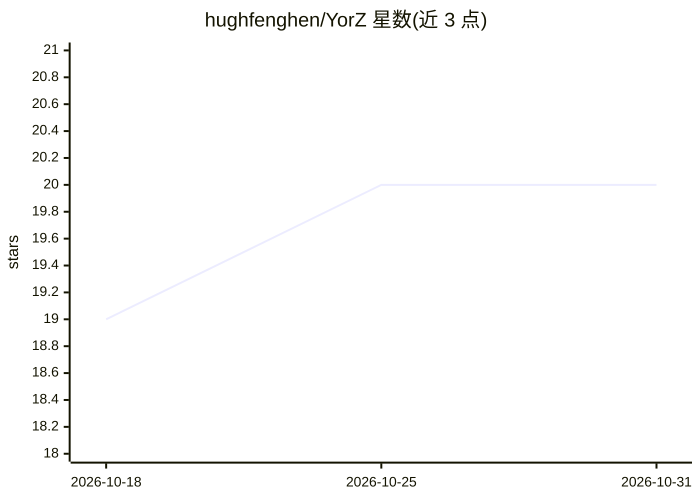

# hughfenghen/YorZ

⭐ 20 · TypeScript · LGPL-3.0 · 推送 2026-10-23 · [GitHub](https://github.com/hughfenghen/YorZ) · 个人维护 · 中文 README

**面向 AI Coding Agent 的 Spec 驱动开发与可视化定制 UI**

为 Claude / Codex 等 Agent 提供的编码工作台：内置 spec 驱动开发（SDD）工作流，支持多任务并发隔离运行与多 Agent 切换，以移动优先的极简 UI 呈现（声称可躺姿操作），并通过技术图表将文档与代码转为可视化以辅助决策。以 npm 包 @yorz/cli 安装，运行 yorz serve 启动后台服务，浏览器访问 localhost:7423 使用仪表盘。要求 Node.js >= 22.19.0。

## 筛选速览

| 维度 | 判定 | 备注 |
|---|---|---|
| AI 角色 | `ai-ecosystem` | LLM/agent 周边工具 |
| 许可风险 | `viral` | LGPL-3.0 |
| 部署形态 | `library` | 以包/库形式分发 |
| 模型依赖 | — | README 未给出锁定关系 |
| 硬件要求 | — | 无带数字的原话,不猜 |
| 安装摩擦 | `low` | 无编译、无系统依赖或容器化 |
| 成熟度 | — | 结构信号不足 |

## 能力要点

- 内置 spec 驱动开发（SDD）工作流
- 多 Agent 并发任务隔离运行，支持主流 Agent 切换
- 技术方案图表化，从图而非文档理解项目
- 移动优先的极简交互设计

## 适用场景

- 让 Claude / Codex 同时跑多个编码任务互不干扰
- 用 Spec 工作流管理大型项目的复杂需求
- 通过可视化图表理解技术方案再做决策

## 场景标签

`编码 Agent` · 领域:编码与开发

## 证据(README 行号)

> L9: _Let Claude / Codex run 10 tasks at once, with zero interference_
> L25: - Built-in spec-driven development workflow that tames large projects and complex requirements
> L28: - Compatible with mainstream Agents, with seamless multi-Agent switching

## 星数曲线

2026-10-18 19 → 2026-10-31 20（+1）

---
*卡片 v1 · prompt 1.4 · 生成 2026-10-28 · 置信度 high · 依据 README sha `5ad0579037c1` · [字段定义](../../DATASET.md)*
