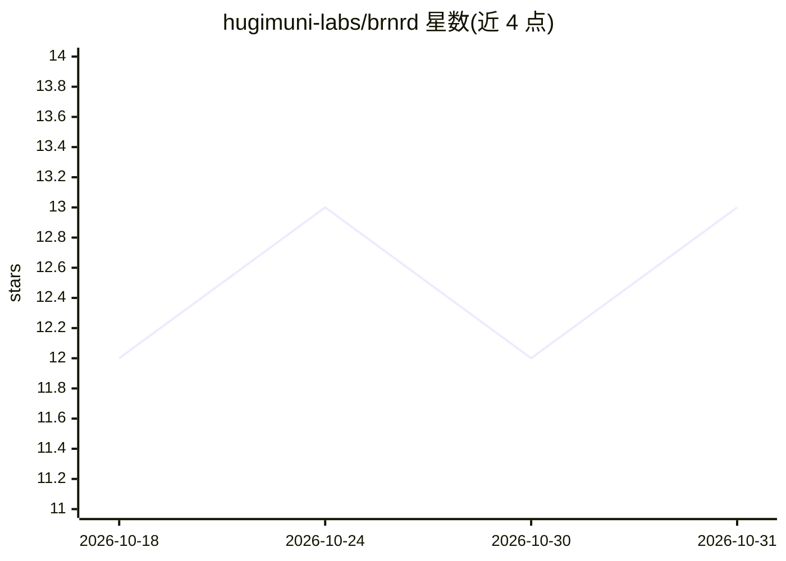

# hugimuni-labs/brnrd

⭐ 13 · Python · MIT · 推送 2026-10-30 · [GitHub](https://github.com/hugimuni-labs/brnrd) · [官网](https://brnrd.dev) · 组织维护

**让 CLI 编码 agent 常驻本机并从聊天工具远程驱动的守护进程**

面向已订阅 Claude Code、Codex、Grok 等编码 agent 的开发者：brnrd 是部署在用户自有机器上的守护进程/运行时，让 CLI agent 在终端会话结束后持续运行、跨重启存活，并通过 Telegram、Slack、WhatsApp、GitHub 等入口远程接收任务。它不自带模型、无需 API key，而是调用既有 CLI harness；提供跨运行持久记忆（以 git 文件存储）、host/worktree/docker/solitary 四种执行环境与发送者授权机制。自述为 alpha，npm 包实为 Python 程序的启动器。

## 筛选速览

| 维度 | 判定 | 备注 |
|---|---|---|
| AI 角色 | `ai-ecosystem` | LLM/agent 周边工具 |
| 许可风险 | `permissive` | MIT |
| 部署形态 | `library` | 以包/库形式分发 |
| 模型依赖 | — | README 未给出锁定关系 |
| 硬件要求 | — | 无带数字的原话,不猜 |
| 安装摩擦 | `low` | 无编译、无系统依赖或容器化 |
| 成熟度 | `idea` | |

## 能力要点

- 守护进程让 CLI agent 跨重启持续运行，通过 Telegram/Slack/WhatsApp/GitHub 远程驱动
- 复用既有 Claude/Codex 订阅调用 CLI harness，无需单独 API key，可在配额用尽时切换模型
- 以 git 文件保存的常驻记忆与 playbook，跨运行与跨仓库保持连续性
- host/worktree/docker/solitary 四种执行环境与按 gate 的发送者授权

## 适用场景

- 离开终端后从手机经 Telegram 给本地 Claude Code/Codex 派发编码任务
- 让编码 agent 7x24 在家里的小型服务器/VPS 上持续工作
- 跟踪并中途纠正长时间运行的多仓库编码任务

## 场景标签

`编码 Agent` · 领域:编码与开发

## 证据(README 行号)

> L7:  brnrd is the daemon: it keeps the agent alive across reboots, lets you drive it from Telegram, Slack or WhatsApp, r
> L28: brnrd is **not another coding agent.** It runs the CLI agents you already chose —
> L74: - **Use existing CLI-agent subscriptions.** brnrd invokes supported CLI

## 星数曲线

2026-10-18 12 → 2026-10-31 13（+1）

---
*卡片 v1 · prompt 1.4 · 生成 2026-10-31 · 置信度 high · 依据 README sha `235e0a02976a` · [字段定义](../../DATASET.md)*
