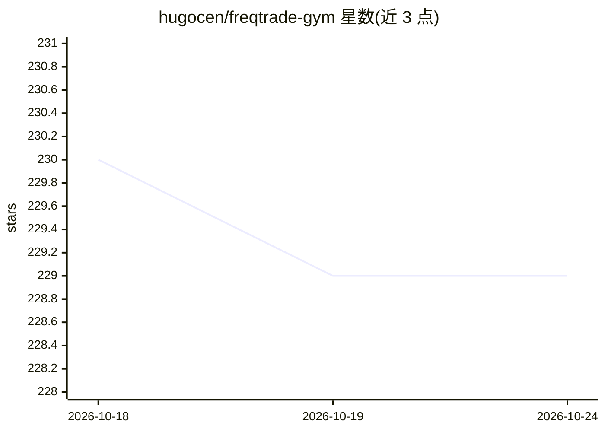

# hugocen/freqtrade-gym

⭐ 229 · Python · GPL-3.0 · 推送 2026-01-08 · [GitHub](https://github.com/hugocen/freqtrade-gym) · 个人维护

**基于 freqtrade 的加密货币交易强化学习 gym 环境**

在 freqtrade 交易框架之上定制的 OpenAI Gym 环境，用于开发和比较加密货币交易中的强化学习算法。提供 baseline（deep_rl.py，基于 stable-baselines）与 RLlib（rllib_example.py）两个训练示例，用 IndicatorforRL.py 做特征提取，可通过 LoadRLModel.py 将训练好的模型加载回 freqtrade 做回测或 dry-run 交易。安装需手动复制多个文件到 freqtrade 目录，作者声明项目处于早期阶段，配置需手工匹配特征名与数量。仅供教育用途。

## 筛选速览

| 维度 | 判定 | 备注 |
|---|---|---|
| AI 角色 | `ai-ecosystem` | LLM/agent 周边工具 |
| 许可风险 | `viral` | GPL-3.0 |
| 部署形态 | `library` | 以包/库形式分发 |
| 模型依赖 | — | README 未给出锁定关系 |
| 硬件要求 | — | 无带数字的原话,不猜 |
| 安装摩擦 | `medium` | 含编译或系统依赖之一 |
| 成熟度 | `idea` | |

## 能力要点

- 为 freqtrade 定制的 gym 环境，支持强化学习算法训练
- 提供 stable-baselines 与 RLlib 两个训练示例
- 支持将训练模型加载回 freqtrade 进行回测与 dry-run 交易
- 可配合 tensorboard 监控训练过程

## 适用场景

- 在加密货币历史行情上训练强化学习交易智能体
- 比较不同 RL 算法在交易任务上的表现
- 将训练好的 RL 模型接入 freqtrade 做回测或模拟交易

## 场景标签

`金融量化` `强化学习` · 领域:学习与行业

## 证据(README 行号)

> L3: This project is base on freqtrade
> L21: ### 3. OpenAI Gym

## 星数曲线

2026-10-18 230 → 2026-10-24 229（-1）

---
*卡片 v1 · prompt 1.4 · 生成 2026-10-22 · 置信度 high · 依据 README sha `66d82227a7db` · [字段定义](../../DATASET.md)*
