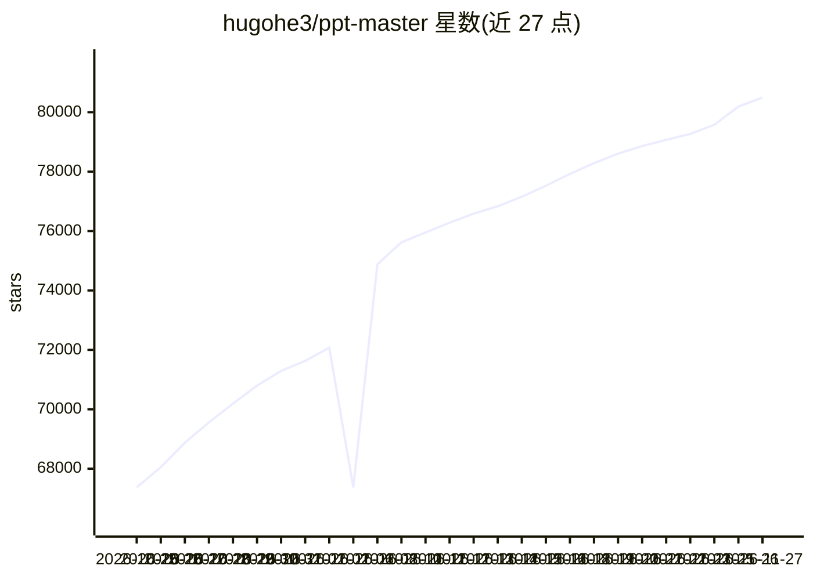

# hugohe3/ppt-master

⭐ 80,496 · Python · MIT · 推送 2026-11-20 · [GitHub](https://github.com/hugohe3/ppt-master) · [官网](https://hugohe3.github.io/ppt-master-examples/) · 个人维护 · 中文 README

**用 AI 工具从文档或主题生成原生可编辑 PPTX 的工作流**

PPT Master 是运行在具备 agent 能力的 AI 工具（如 Claude Code）中的本地工作流：用户给出主题或源文件（PDF、DOCX、网页等），由 AI 在本地完成分析、分页设计与导出，生成原生可编辑的 .pptx，包含原生形状、母版/版式、数据图表与表格、过渡动画、旁白音频等。它本身是流程定义而非模型，效果取决于所用模型（README 建议大上下文窗口模型），token 消耗较高；除模型调用及可选的搜索/图像/语音服务外，数据留在本机。

## 筛选速览

| 维度 | 判定 | 备注 |
|---|---|---|
| AI 角色 | `ai-native` | 本体是模型或模型工具 |
| 许可风险 | `permissive` | MIT |
| 部署形态 | `desktop` | 安装包/桌面程序 |
| 模型依赖 | — | README 未给出锁定关系 |
| 硬件要求 | — | 无带数字的原话,不猜 |
| 安装摩擦 | `low` | 无编译、无系统依赖或容器化 |
| 成熟度 | — | 结构信号不足 |

## 动量与使用信号

- 维护:`active` — 距上次 push 0.8 天,年发版 36,25 位贡献者
- 涨星:近 1 天 **+511**(自 20261016 起算)
- 安装:npm 包 `skills` 月下载 23,786,800

## 能力要点

- 生成原生 PowerPoint 对象：形状、母版/版式（p:sldMaster 继承）、数据图表与表格
- 支持从自有 .pptx 模板生成、填充已有演示文稿并保留设计、添加原生动画与旁白
- 本地运行，任何具备 agent 能力的 AI 工具均可驱动
- MIT 许可，免费开源，成本仅为模型 token

## 适用场景

- 把 PDF 或 DOCX 报告转成可继续编辑的 PPT
- 基于公司自有模板生成品牌风格演示文稿
- 为完成的幻灯片添加原生过渡、动画和语音旁白

## 场景标签

`工作流自动化` · 领域:效率与自动化

## 证据(README 行号)

> L73: In practice, it runs as a workflow ("skill") inside any agent-capable AI tool: ask in chat — "make a deck from this
> L81: - **No platform lock-in** — any agent-capable AI tool can drive it; Kimi, Gemini, GPT, Claude, and other models all

## 星数曲线

2026-10-25 67,372 → 2026-11-27 80,496（+13,124）

---
*卡片 v1 · prompt 1.4 · 生成 2026-11-22 · 置信度 mid · 依据 README sha `a169826549bc` · [字段定义](../../DATASET.md)*
