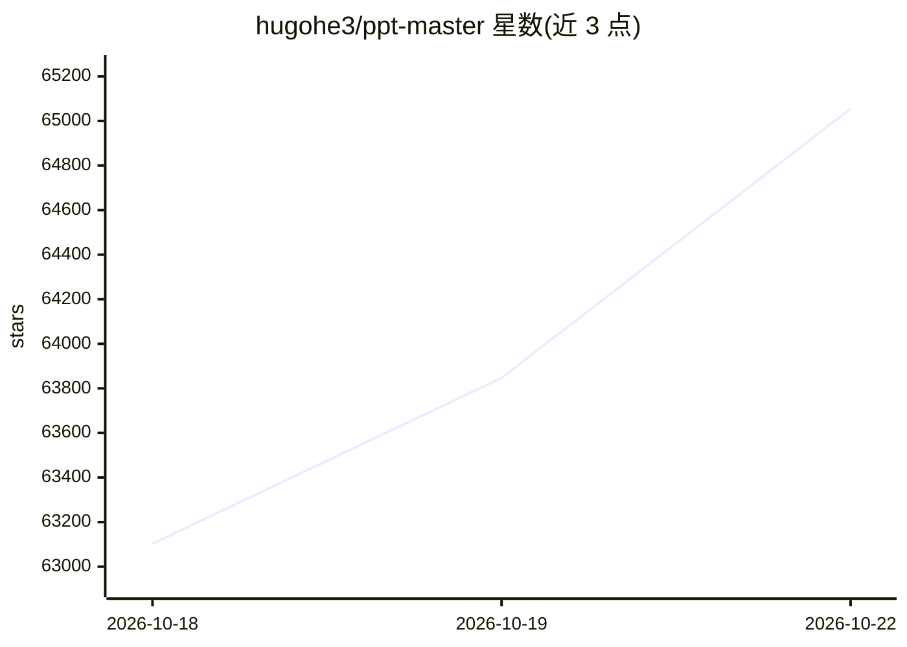

# hugohe3/ppt-master

⭐ 65,055 · Python · MIT · 推送 2026-10-21 · [GitHub](https://github.com/hugohe3/ppt-master) · [官网](https://hugohe3.github.io/ppt-master-examples/) · 个人维护 · 中文 README

**在 AI agent 工具内运行的本地工作流：从文档/主题生成原生 PPTX**

由个人开发者（财务从业者 Hugo He）维护的 Python 工作流（skill）：用户在任意具备 agent 能力的 AI 工具（Claude Code、Cursor 等）的对话中下达指令，工作流在本机运行，读取 PDF/DOCX/网页等材料后生成可继续编辑的原生 .pptx——包含幻灯片母版、原生形状与连接符、数据支撑的图表表格、切换动画与备注语音旁白，支持从参考文档提炼品牌/版式模板并填充既有 .pptx。全程仅 Python 3.10+ 与依赖安装，数据留在本地，模型与平台不锁定。作者声明上限取决于所选模型，推荐大上下文模型并配 AI 生图。

## 筛选速览

| 维度 | 判定 | 备注 |
|---|---|---|
| AI 角色 | `ai-native` | 本体是模型或模型工具 |
| 许可风险 | `permissive` | MIT |
| 部署形态 | `desktop` | 安装包/桌面程序 |
| 模型依赖 | locked-api |  |
| 硬件要求 | — | 无带数字的原话,不猜 |
| 安装摩擦 | `low` | 无编译、无系统依赖或容器化 |
| 成熟度 | — | 结构信号不足 |

## 动量与使用信号

- 维护:`active` — 距上次 push 0.8 天,年发版 36,25 位贡献者
- 涨星:近 1 天 **+511**(自 20261016 起算)
- 安装:npm 包 `skills` 月下载 23,786,800

## 能力要点

- 生成原生 PowerPoint 对象（形状、母版、数据图表），非扁平图片
- 支持自有 .pptx 模板填充与品牌/版式模板提炼
- 本地运行，除模型通信外数据不出机器
- 可在任意具备 agent 能力的 AI 工具中驱动

## 适用场景

- 把论文、报告等文档快速转成可继续编辑的原生 PPT
- 在公司的品牌模板上生成保持设计风格的新演示
- 为已完成的演示添加原生动画、切换与语音旁白

## 场景标签

 · 领域:办公/文档生成

## 证据(README 行号)

> L1: # PPT Master — AI generates native PowerPoint from any document
> L66: In form, it's a workflow (a "skill") that runs inside any agent-capable AI tool: tell it in chat — "make a deck fro
> L73: - **Data stays local** — apart from AI model communication, the entire pipeline runs on your machine

## 星数曲线

2026-10-18 63,103 → 2026-10-22 65,055（+1,952）

---
*卡片 v1 · prompt 1.4 · 生成 2026-10-20 · 置信度 mid · 依据 README sha `072da1e21449` · [字段定义](../../DATASET.md)*
