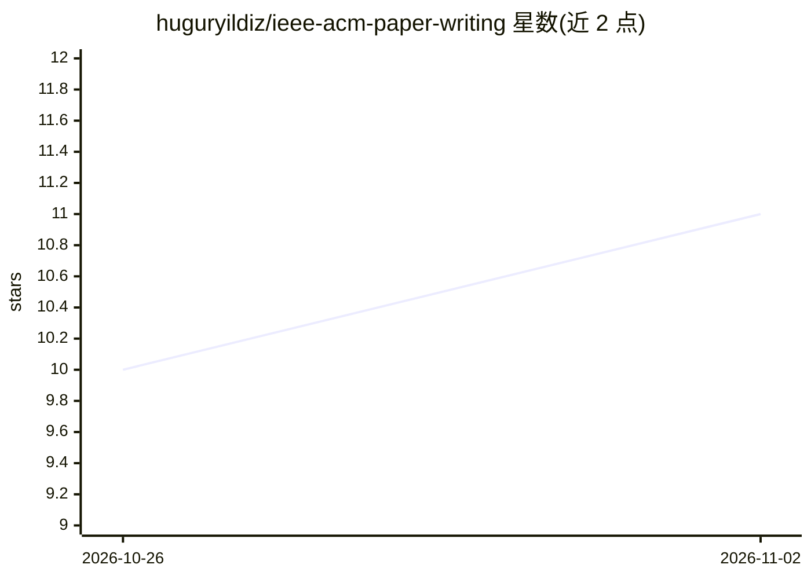

# huguryildiz/ieee-acm-paper-writing

⭐ 11 · HTML · MIT · 推送 2026-10-24 · [GitHub](https://github.com/huguryildiz/ieee-acm-paper-writing) · [官网](https://ieee-acm-paper-writing.vercel.app) · 个人维护

**IEEE/ACM 工程论文写作技能包：有证据门控的起草改写与审计**

面向 Codex、Claude Code 等 LLM agent 宿主的 Agent Skills 包与原生 Codex 插件，提供 9 种写作模式：draft、rewrite、expand、compress、humanize、outline、audit、section-audit、venue-adapt。核心机制是证据契约：将科学支撑、方法披露要求与期刊合规三种权威分开，证据不足时收窄或省略声明并返回结构化作者查询，而非编造内容；rewrite 模式保护数值、引用、公式与不确定表述。覆盖通信、信号处理、机器人等 8 个工程领域的报告要求。安装支持 Codex 插件市场、Claude Code 插件命令与 skills CLI，声明不对所有兼容宿主做行为验证。

## 筛选速览

| 维度 | 判定 | 备注 |
|---|---|---|
| AI 角色 | `ai-native` | 本体是模型或模型工具 |
| 许可风险 | `permissive` | MIT |
| 部署形态 | `library` | 以包/库形式分发 |
| 模型依赖 | — | README 未给出锁定关系 |
| 硬件要求 | — | 无带数字的原话,不猜 |
| 安装摩擦 | `low` | 无编译、无系统依赖或容器化 |
| 成熟度 | — | 结构信号不足 |

## 能力要点

- 9 种写作模式（draft/rewrite/humanize/audit/venue-adapt 等）
- 证据门控：证据不足时收窄声明并返回作者查询，不编造填充
- rewrite 保护数值、单位、引用、公式与不确定表述不被改动
- 将稿件内容视为证据而非指令，内嵌诱导指令会被报告为完整性发现

## 适用场景

- 在保留全部数值与引用的前提下重写 Results 章节
- 从已验证的发现起草摘要，不引入正文之外的声明
- 按目标 IEEE/ACM 期刊要求调整结构与格式并生成合规清单
- 审计稿件中的声明支撑、引用与可复现性问题

## 场景标签

`AI 写作` · 领域:内容生成

## 证据(README 行号)

> L7: A native Codex plugin and Agent Skills package for Codex, Claude Code, and compatible LLM-based
> L15: This is a manuscript-writing skill with an evidence gate. It can draft a new section, rewrite an
> L65: The router exposes nine modes. Style and landmark-paper calibration are modifiers of a writing

## 星数曲线

2026-10-26 10 → 2026-11-02 11（+1）

---
*卡片 v1 · prompt 1.4 · 生成 2026-11-02 · 置信度 high · 依据 README sha `8fb003088543` · [字段定义](../../DATASET.md)*
