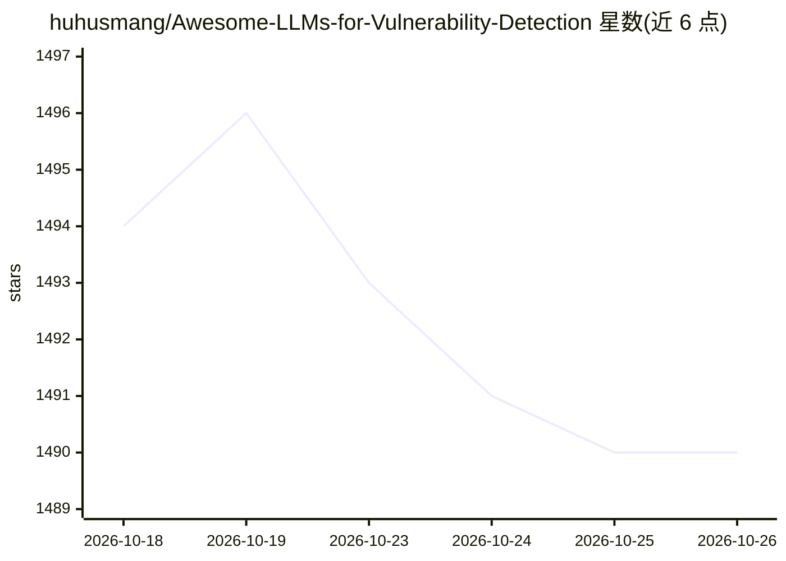

# huhusmang/Awesome-LLMs-for-Vulnerability-Detection

⭐ 1,490 · Python · MIT · 推送 2026-10-25 · [GitHub](https://github.com/huhusmang/Awesome-LLMs-for-Vulnerability-Detection) · 个人维护

**LLM 漏洞检测研究论文与项目的策展清单**

持续更新的 awesome 清单，收录 2025 年及以后关于 LLM 用于软件漏洞检测与发现的论文条目，覆盖函数级、仓库级、agentic、智能合约等方向；另列开源项目（自动渗透测试、多 agent 审计平台）与 agent 技能（OpenAI/Anthropic/Cloudflare 相关安全扫描技能）。通过 GitHub Actions 工作流按关键词自动抓取并每日更新 arXiv 论文（arxiv.md），更新流程基于 LLM4SE 项目重构。仅提供链接索引，无可安装本体。

## 筛选速览

| 维度 | 判定 | 备注 |
|---|---|---|
| AI 角色 | `ai-knowledge` | 知识聚合/清单类 |
| 许可风险 | `permissive` | MIT |
| 部署形态 | `None` |  |
| 模型依赖 | — | README 未给出锁定关系 |
| 硬件要求 | — | 无带数字的原话,不猜 |
| 安装摩擦 | `low` | 无编译、无系统依赖或容器化 |
| 成熟度 | — | 结构信号不足 |

## 能力要点

- 收录 2025+ 漏洞检测 LLM 论文条目（含 venue 与 GitHub 链接）
- 另含开源安全项目与 agent 技能两个板块
- arXiv 论文每日自动抓取与更新工作流

## 适用场景

- 查阅 LLM 漏洞检测方向的最新论文与代码
- 寻找可用于漏洞发现的开源 agent 项目与技能
- 追踪该领域的基准与评测研究进展

## 场景标签

`精选清单` `网络安全` · 领域:学习与行业

## 证据(README 行号)

> L3: A curated list of papers, projects, and agent skills on using LLMs for vulnerability detection and discovery.
> L5: ## 📄 Papers
> L68: ## 📡 arxiv.md

## 星数曲线

2026-10-18 1,494 → 2026-10-26 1,490（-4）

---
*卡片 v1 · prompt 1.4 · 生成 2026-10-21 · 置信度 high · 依据 README sha `bcdc14ba3fc4` · [字段定义](../../DATASET.md)*
