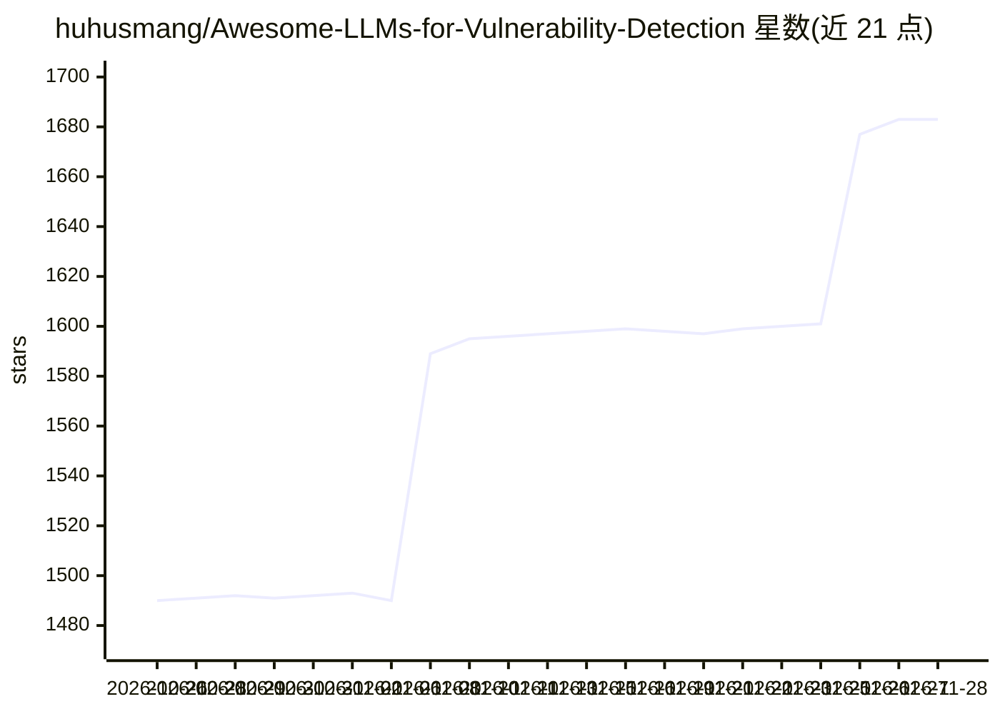

# huhusmang/Awesome-LLMs-for-Vulnerability-Detection

⭐ 1,683 · Python · MIT · 推送 2026-11-27 · [GitHub](https://github.com/huhusmang/Awesome-LLMs-for-Vulnerability-Detection) · 个人维护

**LLM 漏洞检测研究的持续更新论文与项目索引清单**

按类组织的论文、项目与 agent 技能索引，覆盖函数级、仓库级、agentic 与智能合约漏洞检测研究，并收录数据集、基准与综述（据仓库描述）。正文分三节：2026 年起的论文表（含会议、年份、论文与 Github 链接）、白盒/渗透测试类安全工具项目表、以及面向 Claude Code/Codex 的安全审计 agent 技能表。通过 GitHub Actions 工作流每日自动抓取并更新指定关键词的 Arxiv 论文，该流程改自 LLM4SE。

## 筛选速览

| 维度 | 判定 | 备注 |
|---|---|---|
| AI 角色 | `ai-knowledge` | 知识聚合/清单类 |
| 许可风险 | `permissive` | MIT |
| 部署形态 | `None` |  |
| 模型依赖 | — | README 未给出锁定关系 |
| 硬件要求 | — | 无带数字的原话,不猜 |
| 安装摩擦 | `low` | 无编译、无系统依赖或容器化 |
| 成熟度 | — | 结构信号不足 |

## 能力要点

- 论文按标题/会议/年份/链接表格组织，2025 年及更早归档至 Papers Archive
- 收录白盒审计、渗透测试等安全工具项目及其 Github 链接
- arxiv.md：通过 workflow 每日自动抓取指定关键词的 Arxiv 论文

## 适用场景

- 查找 LLM 漏洞检测方向的最新论文与基准
- 为安全审计选型浏览相关开源工具与 agent 技能
- 跟踪该领域的每日 Arxiv 更新

## 场景标签

`精选清单` `网络安全` · 领域:学习与行业

## 证据(README 行号)

> L1: # Awesome Large Language Models for Vulnerability Detection
> L3: A curated list of papers, projects, and agent skills on using LLMs for vulnerability detection and discovery.
> L5: ## 📄 Papers

## 星数曲线

2026-10-26 1,490 → 2026-11-28 1,683（+193）

---
*卡片 v1 · prompt 1.4 · 生成 2026-11-26 · 置信度 high · 依据 README sha `a0aa0a6a72a9` · [字段定义](../../DATASET.md)*
