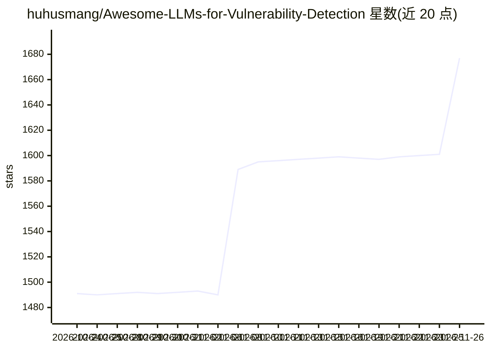

# huhusmang/Awesome-LLMs-for-Vulnerability-Detection

⭐ 1,677 · Python · MIT · 推送 2026-11-25 · [GitHub](https://github.com/huhusmang/Awesome-LLMs-for-Vulnerability-Detection) · 个人维护

**面向安全研究者的 LLM 漏洞检测论文与项目索引**

关于 LLM 软件漏洞检测研究的持续更新策展清单：收录 2025 年以来的论文（涵盖函数级、仓库级、agentic 与智能合约检测、数据集、基准与综述），并列出相关开源项目与 agent 技能条目。通过 GitHub workflow 每日按关键词自动抓取并更新 Arxiv 论文，旧论文归档于 2024 及更早的 Papers Archive，适合作为该领域研究的检索入口。

## 筛选速览

| 维度 | 判定 | 备注 |
|---|---|---|
| AI 角色 | `ai-knowledge` | 知识聚合/清单类 |
| 许可风险 | `permissive` | MIT |
| 部署形态 | `None` |  |
| 模型依赖 | — | README 未给出锁定关系 |
| 硬件要求 | — | 无带数字的原话,不猜 |
| 安装摩擦 | `low` | 无编译、无系统依赖或容器化 |
| 成熟度 | — | 结构信号不足 |

## 能力要点

- 持续更新的 LLM 漏洞检测论文索引，按年份与发表载体组织
- 收录相关开源项目与 Claude Code/Codex 类 agent 安全技能条目
- 每日自动抓取 Arxiv 关键词论文的 workflow

## 适用场景

- 调研 LLM 漏洞检测领域的研究进展
- 为代码安全审计选型相关开源工具与 agent 技能
- 跟踪每日新发布的 Arxiv 漏洞检测论文

## 场景标签

`精选清单` `网络安全` · 领域:学习与行业

## 证据(README 行号)

> L3: A curated list of papers, projects, and agent skills on using LLMs for vulnerability detection and discovery.
> L5: ## 📄 Papers
> L70: Automated daily capture and update of Arxiv papers for specified keywords through workflows.

## 星数曲线

2026-10-24 1,491 → 2026-11-26 1,677（+186）

---
*卡片 v1 · prompt 1.4 · 生成 2026-11-23 · 置信度 high · 依据 README sha `fa0453dfa09b` · [字段定义](../../DATASET.md)*
