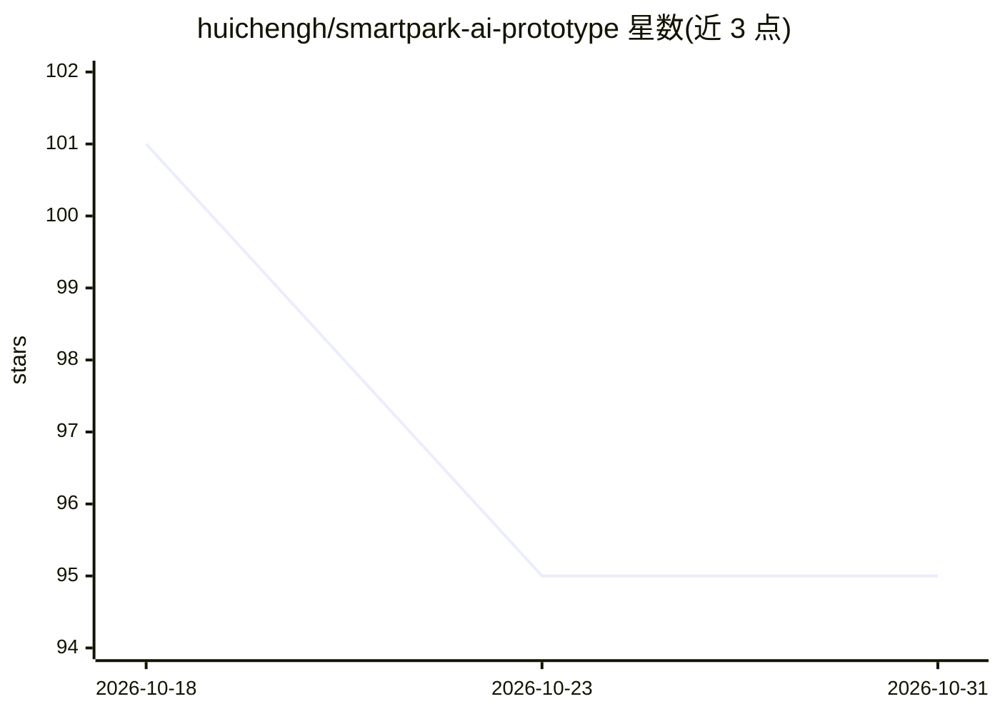

# huichengh/smartpark-ai-prototype

⭐ 95 · Python · 推送 2026-09-17 · [GitHub](https://github.com/huichengh/smartpark-ai-prototype) · [官网](https://smartpark-prototype.app.workbuddy.host/) · 个人维护 · 中文 README

**多园区多租户产业园区运营平台原型，含 AI Agent 编排验证**

「基于 AI Agent 的产业园区项目管理研究」配套的原型验证平台，定位为验证多园区、多租户场景下的数据模型、RBAC+数据范围双层权限体系与 AI Agent 编排思路。整合空间资产、招商运营、合同财务、项目管理与物业运维等 17 个业务路由模块、22 个前端页面；AI 部分含 11 个子智能体与 23 个工具，默认本地确定性规则推理（AGENT_MODE=rule），可切换接入大模型。README 明确声明其为原型，性能、安全、合规未按生产标准打磨，数据为模拟演示数据。技术栈为 FastAPI + React，演示库默认 SQLite 可切 PostgreSQL。

## 筛选速览

| 维度 | 判定 | 备注 |
|---|---|---|
| AI 角色 | `ai-enhanced` | 去掉 AI 部分产品仍成立 |
| 许可风险 | `none` | — |
| 部署形态 | `library` | 以包/库形式分发 |
| 模型依赖 | — | README 未给出锁定关系 |
| 硬件要求 | — | 无带数字的原话,不猜 |
| 安装摩擦 | `low` | 无编译、无系统依赖或容器化 |
| 成熟度 | `idea` | |

## 能力要点

- RBAC + 数据范围双层权限模型（15 角色 × 198 权限点，后端下推过滤）
- 11 个 AI 子智能体 + 23 个工具，AI 权限三级（L3 高影响动作强制人工审批）
- AGENT_MODE=rule 本地确定性推理，不依赖外部大模型
- 八道自动校验脚本（字段/路由/权限/枚举/工具/意图路由）与浏览器端到端巡检

## 适用场景

- 研究多园区、多租户 SaaS 的权限与数据隔离设计
- 验证 AI Agent 在园区运营场景的编排与审批边界
- 体验带 AI 智能体的园区一体化管理平台原型

## 场景标签

`多智能体` · 领域:Agent 开发

## 证据(README 行号)

> L54: 面向**多园区、多租户**场景的一体化运营平台原型。整合空间资产、招商运营、企业经营、合同财务、
> L55: 项目管理与物业运维，由 AI 智能体贯穿数据洞察、风险预警与决策建议；高风险动作强制走人工审批。

## 星数曲线

2026-10-18 101 → 2026-10-31 95（-6）

---
*卡片 v1 · prompt 1.4 · 生成 2026-10-23 · 置信度 high · 依据 README sha `81e9e622cc1e` · [字段定义](../../DATASET.md)*
