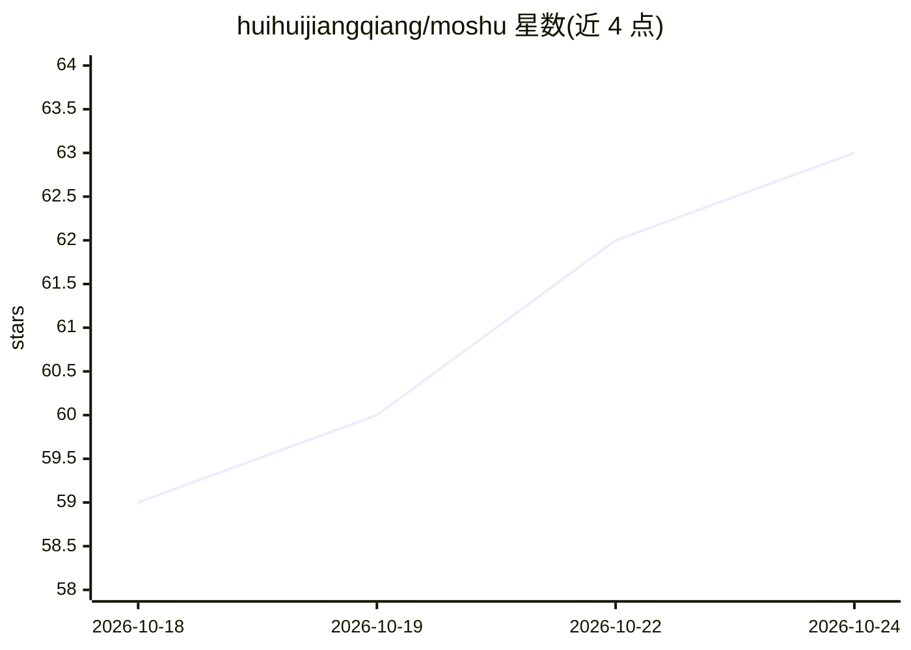

# huihuijiangqiang/moshu

⭐ 63 · Python · MIT · 推送 2026-09-27 · [GitHub](https://github.com/huihuijiangqiang/moshu) · [官网](https://ms.moshu-novel.com/) · 个人维护 · 中文 README

**面向中文长篇网文作者的 AI 小说写作工作台**

面向长篇网文作者的自部署 AI 创作工作台：在统一作品空间中维护大纲、章纲、场景卡片、人物/地点/势力/物品/伏笔设定库与时间线，写作台按章生成 AI 候选草稿（作者采纳后才进入正文），一致性守卫标注冲突来源，自然化审查检查文字节奏，RAG 检索基于 PostgreSQL/pgvector。百万字长篇可拆为 800～32,000 字有序生成段并支持断点恢复。另含漫剧静态分镜管理、用量计费、微信/支付宝支付与 BYOK 模型配置。前端 Vue 3，后端 FastAPI，支持 Docker Compose 与 Windows 启动器（需 Docker Desktop）。当前阶段不生成视频、不做多人实时协作。

## 筛选速览

| 维度 | 判定 | 备注 |
|---|---|---|
| AI 角色 | `ai-native` | 本体是模型或模型工具 |
| 许可风险 | `permissive` | MIT |
| 部署形态 | `desktop` | 安装包/桌面程序 |
| 模型依赖 | local-ok | 支持本地模型 |
| 硬件要求 | — | 无带数字的原话,不猜 |
| 安装摩擦 | `low` | 无编译、无系统依赖或容器化 |
| 成熟度 | `idea` | |

## 能力要点

- AI 草稿需作者确认后进入正文，SSE 中断返回 STREAM_INTERRUPTED 不会污染正文
- 长篇拆分为 800～32,000 字有序生成段，支持断点恢复与段级质量门禁
- 一致性守卫优先确定性规则校验账目，LLM 只负责抽取不负责算术结论
- BYOK：用户可配置 OpenAI 兼容模型服务，embedding 可选本地 Ollama（qwen3-embedding:0.6b）

## 适用场景

- 网文作者连载时维护设定、时间线并让 AI 按章纲续写
- 检查前后文一致性与伏笔冲突后再导出正文和自查报告
- 为漫剧改编准备集/场景/镜头静态分镜和人物视觉档案

## 场景标签

`AI 写作` · 领域:内容生成

## 证据(README 行号)

> L3: > 面向长篇网文作者的 AI 创作工作台：把章纲、设定、正文和一致性证据放在同一个作品空间里。
> L23: 5. **进入写作台**：选择章节，查看本章计划和相关设定，让 AI 生成候选正文或自己直接编辑。AI 草稿需要作者确认后才会进入正文。

## 星数曲线

2026-10-18 59 → 2026-10-24 63（+4）

---
*卡片 v1 · prompt 1.4 · 生成 2026-10-24 · 置信度 high · 依据 README sha `8d99819aef6d` · [字段定义](../../DATASET.md)*
