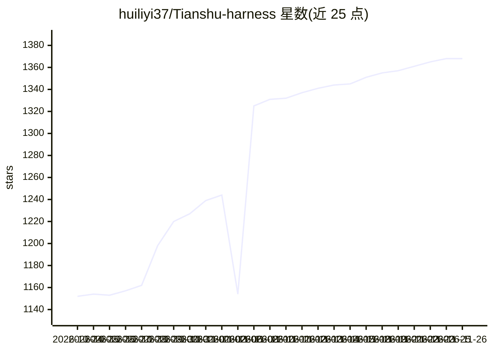

# huiliyi37/Tianshu-harness

⭐ 1,368 · TypeScript · Apache-2.0 · 推送 2026-11-22 · [GitHub](https://github.com/huiliyi37/Tianshu-harness) · [官网](https://tianshuharness.com/) · 个人维护 · 中文 README

**开发者的终端编程 agent 运行时：目标不漂移、交付有验证闭环**

TypeScript 编写的编程 agent 运行时，终端 TUI、桌面端与 VS Code 插件共用同一内核。核心机制是把目标、状态、证据、权限与终止条件从对话历史外部化为认知执行环境 CVM，由运行时经 75 个 hook 模块、Sensorium 状态感知与 deliver_task 交付门做确定性监督；辅以前缀缓存引擎、多代理编排、MCP/Skills 接入。CLI 需 Node 24.22.1+/26.12.1+，桌面端免 Node；README 声明公开实测仅覆盖 DeepSeek。

## 筛选速览

| 维度 | 判定 | 备注 |
|---|---|---|
| AI 角色 | `ai-ecosystem` | LLM/agent 周边工具 |
| 许可风险 | `permissive` | Apache-2.0 |
| 部署形态 | `desktop` | 安装包/桌面程序 |
| 模型依赖 | local-ok | 支持本地模型 |
| 硬件要求 | — | 无带数字的原话,不猜 |
| 安装摩擦 | `low` | 无编译、无系统依赖或容器化 |
| 成熟度 | — | 结构信号不足 |

## 能力要点

- CVM 认知执行环境：任务契约、交付门 deliver_task（RED/YELLOW/GREEN）、75 个运行时 hook 外环监督
- 前缀缓存优先设计：5 个真实会话缓存命中率 99.3–99.6%，附 jq 复算命令
- 终端 TUI / 桌面端 / VS Code 插件共用一个内核，桌面端含离线语音输入与手机遥控审批
- 内置 25 项服务商预设，支持任意 OpenAI 兼容端点

## 适用场景

- 让 agent 修测试、改代码并拿到带验证状态的交付报告
- 在 CI 或脚本里用无头模式跑目标驱动的自主任务
- 长会话下控制 LLM 调用成本与缓存命中
- 接入 MCP 服务器与自定义工具扩展 agent 能力

## 场景标签

`编码 Agent` `AI 助手` · 领域:编码与开发

## 证据(README 行号)

> L38: **天枢**是一个 TypeScript 编写的编程 agent 运行时，终端 TUI、桌面端和 VS Code 插件共用同一个内核。它在模型和真实世界之间加了一层**认知执行环境 CVM**（Cognitive Virtual 
> L223: 内置 25 项服务商预设，会话内 `/model` 随时切换，也支持任意 OpenAI 兼容端点（Ollama、vLLM、one-api 中转等）。
> L64: npm install -g tianshu-harness

## 星数曲线

2026-10-24 1,152 → 2026-11-26 1,368（+216）

---
*卡片 v1 · prompt 1.4 · 生成 2026-11-23 · 置信度 high · 依据 README sha `feb103ef5cba` · [字段定义](../../DATASET.md)*
