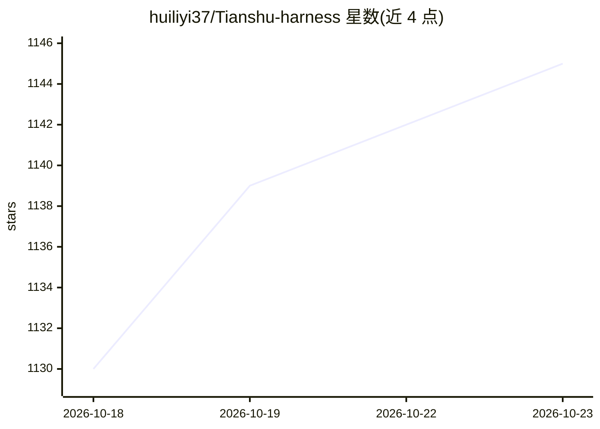

# huiliyi37/Tianshu-harness

⭐ 1,145 · TypeScript · Apache-2.0 · 推送 2026-10-22 · [GitHub](https://github.com/huiliyi37/Tianshu-harness) · [官网](https://tianshuharness.com/) · 个人维护 · 中文 README

**面向开发者的终端/桌面编程 agent 认知运行时，证据驱动交付**

TypeScript 编写的编程 agent 运行时，终端 TUI 与 Tauri 桌面端（macOS/Windows/Linux）共享同一内核。核心机制是认知执行环境（CVM）：TaskContract 钉住目标、交付门禁要求完成声明附带测试/diff/验证命令等运行时证据、75 个 hook 拦截认知退化、前缀缓存引擎降低 token 成本。支持 DeepSeek、Claude、GLM、Grok、Gemini 等 25 项预设及任意 OpenAI 兼容端点（Ollama/vLLM）。CLI 需 Node.js ≥ 24，桌面端提供安装包，Windows 依赖 WebView2。

## 筛选速览

| 维度 | 判定 | 备注 |
|---|---|---|
| AI 角色 | `ai-native` | 本体是模型或模型工具 |
| 许可风险 | `permissive` | Apache-2.0 |
| 部署形态 | `desktop` | 安装包/桌面程序 |
| 模型依赖 | local-ok | 支持本地模型 |
| 硬件要求 | — | 无带数字的原话,不猜 |
| 安装摩擦 | `low` | 无编译、无系统依赖或容器化 |
| 成熟度 | — | 结构信号不足 |

## 能力要点

- 交付门禁：完成声明必须带测试/diff/验证命令等运行时证据
- CVM 认知运行时：75 个 hook 横跨 5 阶段拦截目标漂移与空转
- 前缀缓存引擎全模型适用，长会话稳态命中 95–99%
- 终端 TUI 与桌面 GUI（Tauri）共用同一 agent 内核

## 适用场景

- 在终端或桌面让 AI agent 自主完成多步编程任务并验证结果
- 用无头模式（--goal/--stream-json）集成到脚本与 CI
- 通过 Cockpit 驾驶舱审查交付验证、成本与运行时拦截记录

## 场景标签

`编码 Agent` · 领域:编码与开发

## 证据(README 行号)

> L34: > **天枢**是一个 TypeScript 编写的编程 agent 运行时，**终端 TUI** 与**桌面 GUI** 共享同一内核。它要回答的核心问题是：**模型何以稳定地交付——目标不漂移、完成有证据、验证有闭环，不说"应
> L43:        Foundation Models          ← DeepSeek · GLM · Claude · Codex · Grok · MiniMax · MiMo …
> L138: **① 交付报告** —— 收尾时天枢会调用 `deliver_task`，输出一块交付报告：交付门状态（GREEN / YELLOW / RED）、本次改动的文件、跑过的验证、逐条完成度审计。「完成」必须有证据；没有证据的收尾

## 星数曲线

2026-10-18 1,130 → 2026-10-23 1,145（+15）

---
*卡片 v1 · prompt 1.4 · 生成 2026-10-21 · 置信度 high · 依据 README sha `ab3c5b9f6f68` · [字段定义](../../DATASET.md)*
