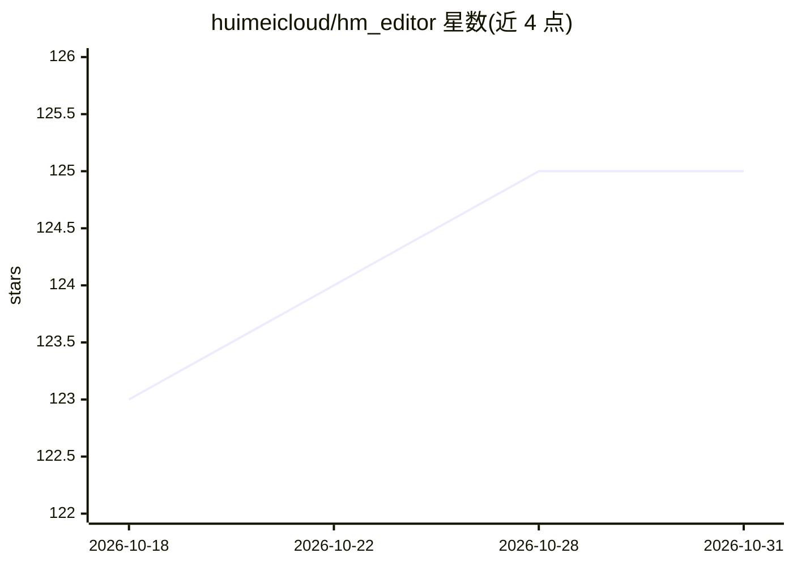

# huimeicloud/hm_editor

⭐ 125 · HTML · LGPL-2.1 · 推送 2026-09-30 · [GitHub](https://github.com/huimeicloud/hm_editor) · [官网](https://editor.huimei.com/) · 组织维护 · 中文 README

**面向医疗信息化的开源电子病历编辑器内核，支持AI服务对接**

惠每云（HMCLOUD）开源的医疗电子病历编辑器插件，基于 CKEditor4，纯前端 JavaScript 运行，为医院信息科和 EMR 厂商提供结构化病历编辑方案。提供文本、时间、单选多选、表格、图片等数据元组件，支持病历模板创建、修订、只读、水印与 AI 服务对接，宣称兼容国产操作系统（信创）。部署方式包括 docker-compose 与源码 npm/grunt 编译，官网 CDN 提供 SDK 脚本，约 15 行代码可集成。LGPLv2.1 协议，GitHub Issue 功能尚未开放，通过钉钉群交流。

## 筛选速览

| 维度 | 判定 | 备注 |
|---|---|---|
| AI 角色 | `ai-ecosystem` | LLM/agent 周边工具 |
| 许可风险 | `viral` | LGPL-2.1 |
| 部署形态 | `library` | 以包/库形式分发 |
| 模型依赖 | — | README 未给出锁定关系 |
| 硬件要求 | — | 无带数字的原话,不猜 |
| 安装摩擦 | `low` | 无编译、无系统依赖或容器化 |
| 成熟度 | — | 结构信号不足 |

## 能力要点

- 基于 CKEditor4 的纯前端编辑器插件，支持多平台与信创环境
- 文本/时间/单选/多选/下拉/表格/图片等数据元组件与数据绑定
- 修订、只读、水印与 AI 服务对接
- 提供 Docker 部署与源码编译两种部署方式

## 适用场景

- 医院信息科在 EMR 系统中集成结构化病历编辑
- EMR 厂商快速嵌入病历编辑器并对接 AI 服务
- 创建和编辑多种病历模板

## 场景标签

 · 领域:医疗信息化/前端编辑器

## 证据(README 行号)

> L15: HmEditor 是一款专为医疗行业设计的智能电子病历编辑器插件，结合 CKEditor4 文本编辑功能与自研 AI 技术，为医院信息科和 EMR 厂商提供高效、灵活、智能化的病历编辑解决方案。支持多种病历模板创建与编辑，具备强大
> L21: - 智能病历编辑：修订、只读、水印、AI 服务对接

## 星数曲线

2026-10-18 123 → 2026-10-31 125（+2）

---
*卡片 v1 · prompt 1.4 · 生成 2026-10-23 · 置信度 mid · 依据 README sha `19f1ac88f85c` · [字段定义](../../DATASET.md)*
