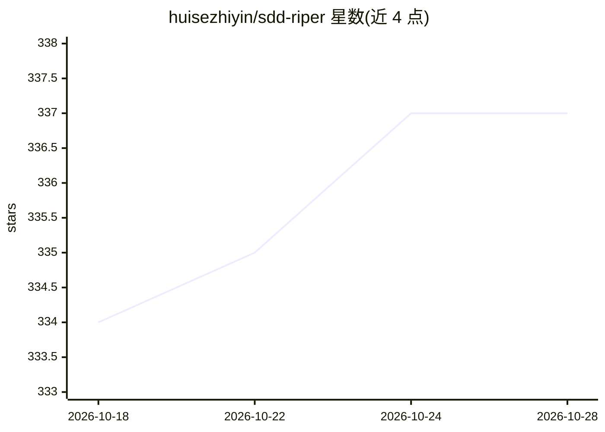

# huisezhiyin/sdd-riper

⭐ 337 · Python · 推送 2026-08-28 · [GitHub](https://github.com/huisezhiyin/sdd-riper) · 个人维护 · 中文 README

**面向 agentic coding 的轻量控制框架：人掌舵、模型推进、留存证据**

仓库原生（repo-native）的 AI 编码代理控制框架（harness），以四个可复用技能组织：sdd-riper-one-light 与 sdd-riper-one 控制执行、检查点、验证与反向同步；codemap 为陌生代码生成代理可用的上下文索引；new-chat-ready 生成新会话交接与恢复包。硬性规则包括先复述任务、无规格不写码、无批准不执行、完成须以证据证明，并区分特征规格、项目记忆与系统级默认三层边界，默认不提交记忆与交接文件。适用于 Codex、Claude Code 等 agentic 编码环境，通过提示词引用技能而非独立安装。

## 筛选速览

| 维度 | 判定 | 备注 |
|---|---|---|
| AI 角色 | `ai-ecosystem` | LLM/agent 周边工具 |
| 许可风险 | `none` | — |
| 部署形态 | `None` |  |
| 模型依赖 | — | README 未给出锁定关系 |
| 硬件要求 | — | 无带数字的原话,不猜 |
| 安装摩擦 | `low` | 无编译、无系统依赖或容器化 |
| 成熟度 | — | 结构信号不足 |

## 能力要点

- 四个技能：轻量/严格两种控制协议、代码地形索引、新会话交接
- 硬性规则：先复述、无规格不码、无批准不执行、完成须以证据证明
- 规格/项目记忆/系统级默认三层边界划分与隐私提交规则
- 多仓库工作协议：通过项目注册表分仓加载而非一次性摄取

## 适用场景

- 在日常编码和重构中给强模型加检查点与审批控制
- 接手陌生代码库时先生成 agent 可用的代码索引
- 长任务跨会话交接与上下文压缩恢复
- 高风险重构或需要审计痕迹的工作切换到严格协议

## 场景标签

`编码 Agent` `提示工程` · 领域:Agent 开发

## 证据(README 行号)

> L11: SDD-RIPER is a small, repo-native harness for that control problem. It is not a magic prompt and it is not heavywei
> L69: For Codex, Claude Code, and other agentic coding environments, the smallest useful repo layout is:
> L90: read context -> restate goal and risk -> checkpoint -> execute -> validate -> reverse sync

## 星数曲线

2026-10-18 334 → 2026-10-28 337（+3）

---
*卡片 v1 · prompt 1.4 · 生成 2026-10-21 · 置信度 high · 依据 README sha `d2fb044a5604` · [字段定义](../../DATASET.md)*
