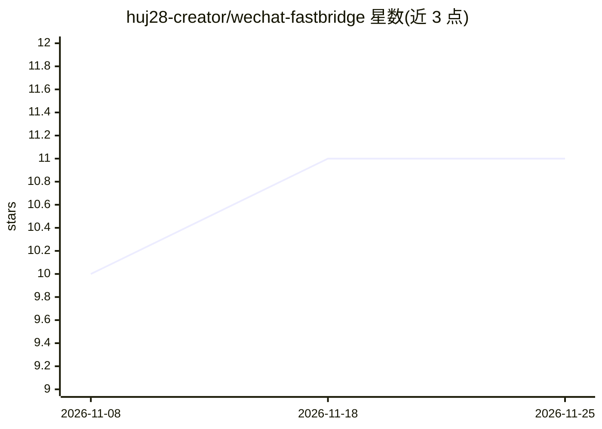

# huj28-creator/wechat-fastbridge

⭐ 11 · JavaScript · MIT · 推送 2026-07-22 · [GitHub](https://github.com/huj28-creator/wechat-fastbridge) · [官网](https://github.com/huj28-creator/wechat-fastbridge) · 个人维护 · 中文 README

**让 Codex 快速读写 macOS 微信消息的本地 MCP 桥**

面向使用 Codex 的 macOS 用户，提供一个本地 STDIO MCP 服务器，包含六个语义工具（状态、读取、发文本、发媒体、聊天等待、白名单收件箱等待），通过打包的原生桥调用 macOS 辅助功能 API 操作微信，避免向模型输入截图或完整辅助功能树。带自适应上下文机制：未变化读取返回零消息，变化时仅返回新消息与少量上下文行，事实胶囊为抽取式不做生成。限制：仅支持 macOS 13+，需微信 Mac 版、Node.js 20 与辅助功能权限，微信 UI 变更可能需要更新选择器。

## 筛选速览

| 维度 | 判定 | 备注 |
|---|---|---|
| AI 角色 | `ai-ecosystem` | LLM/agent 周边工具 |
| 许可风险 | `permissive` | MIT |
| 部署形态 | `self-host` | docker 或自建部署 |
| 模型依赖 | — | README 未给出锁定关系 |
| 硬件要求 | — | 无带数字的原话,不猜 |
| 安装摩擦 | `low` | 无编译、无系统依赖或容器化 |
| 成熟度 | — | 结构信号不足 |

## 能力要点

- 六个语义工具的本地 STDIO MCP 服务器
- 打包 Intel + Apple Silicon 原生桥，基于 macOS 辅助功能 API
- 自适应上下文：签名增量读取，未变化返回零消息，事实胶囊为抽取式
- 白名单收件箱自动回复模式，内容留在本机，无云中继

## 适用场景

- 让 Codex 代理读取和回复 macOS 微信消息
- 多聊天客服自动应答（白名单与升级规则由用户设定）
- 通过命令向指定聊天发送文本、文件或收藏表情

## 场景标签

`GUI 自动化` · 领域:效率与自动化

## 证据(README 行号)

> L9: - a local STDIO MCP server with six semantic tools: status, read, text send, media send, chat wait, and allowlisted 
> L11: - a thin Codex skill that selects the fast path and falls back to Computer Use only when necessary.
> L37: - Codex desktop, CLI, or IDE extension

## 星数曲线

2026-11-08 10 → 2026-11-25 11（+1）

---
*卡片 v1 · prompt 1.4 · 生成 2026-11-18 · 置信度 mid · 依据 README sha `b62f2e1beccb` · [字段定义](../../DATASET.md)*
