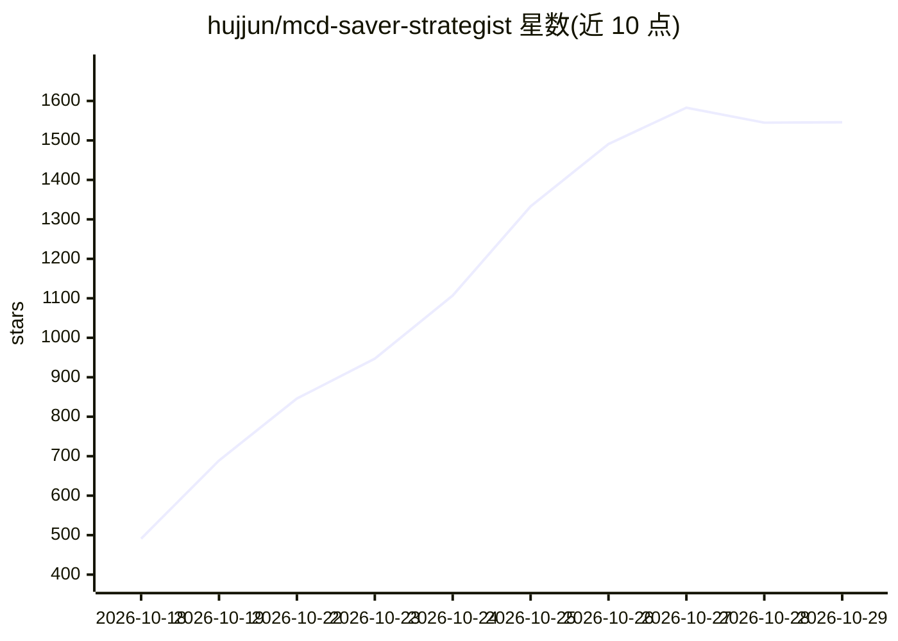

# hujjun/mcd-saver-strategist

⭐ 1,546 · Python · MIT · 推送 2026-10-19 · [GitHub](https://github.com/hujjun/mcd-saver-strategist) · [官网](https://hujjun.github.io/mcd-saver-strategist/) · 个人维护 · 中文 README

**麦当劳点餐省钱 Skill：穷举菜单×优惠券算出最低价组合**

基于麦当劳中国 MCP 的 Agent Skill / MCP 客户端技能，供 WorkBuddy 等 Agent 调用：拉取门店菜单、四路券池优惠券与营养数据，由 optimizer.py 做确定性组合优化（子集和 DP、帕累托前沿），输出总价最低的合规组合并可经 MCP 核价下单。支持多目标（省钱/吃全/低卡/少排队）、券体检、凑单建议与多人拼单。纯 Python 标准库零依赖，需申请麦当劳 MCP Token；为大赛参赛作品，非麦当劳官方产品。

## 筛选速览

| 维度 | 判定 | 备注 |
|---|---|---|
| AI 角色 | `ai-ecosystem` | LLM/agent 周边工具 |
| 许可风险 | `permissive` | MIT |
| 部署形态 | `None` |  |
| 模型依赖 | — | README 未给出锁定关系 |
| 硬件要求 | — | 无带数字的原话,不猜 |
| 安装摩擦 | `low` | 无编译、无系统依赖或容器化 |
| 成熟度 | — | 结构信号不足 |

## 能力要点

- 确定性组合优化输出总价最低的 Top-N 点餐方案（示例：巨无霸套餐 ¥47→¥21.90）
- 券体检：名义面额/实际节省/机会成本三口径评估
- 凑单建议用子集和 DP 求最小代价补位
- 零依赖纯 Python 标准库，内置样例数据可离线跑通

## 适用场景

- 在预算或热量约束下找麦当劳最优点餐组合
- 评估手里多张优惠券哪张值得用
- 多人拼单按保守计价算总价与人均
- 凑满减时算加购是否划算

## 场景标签

`数据分析` · 领域:效率与自动化

## 证据(README 行号)

> L3: > 基于 **麦当劳中国 MCP（McDonald's China MCP）** 开发的省钱点餐 Skill / AI 智能体技能：
> L55: |麦当劳 MCP|实时菜单、价格、优惠券、营养、门店、下单|
> L57: |WorkBuddy Agent|理解需求、归一化数据、讲解方案、确认后下单|

## 星数曲线

2026-10-18 491 → 2026-10-29 1,546（+1,055）

---
*卡片 v1 · prompt 1.4 · 生成 2026-10-21 · 置信度 high · 依据 README sha `942b8c1d12b9` · [字段定义](../../DATASET.md)*
