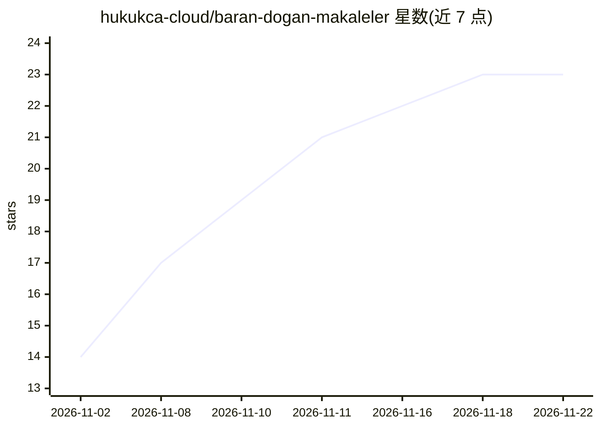

# hukukca-cloud/baran-dogan-makaleler

⭐ 23 · Python · 推送 2026-11-01 · [GitHub](https://github.com/hukukca-cloud/baran-dogan-makaleler) · 个人维护

**土耳其律师法律文章的 AI 友好分类档案，供 Claude/ChatGPT 使用**

经作者授权、以署名和非商业方式汇编 Av. Baran Doğan 在 barandogan.av.tr 发表的法律文章，按 26 个法律领域分类，共 649 篇、约 236 万词。提供按领域/上组/全量的编译文件、单篇引用文件、llms.txt 与 index.json，用于在 Claude/ChatGPT 项目中批量加载；附示例提示与安装指南。因体量约 20MB，建议单次会话只加载领域编译文件，全量文件用于 RAG 环境。每月由 GitHub Actions 自动抓取更新，内容非法律意见。

## 筛选速览

| 维度 | 判定 | 备注 |
|---|---|---|
| AI 角色 | `ai-knowledge` | 知识聚合/清单类 |
| 许可风险 | `none` | — |
| 部署形态 | `library` | 以包/库形式分发 |
| 模型依赖 | — | README 未给出锁定关系 |
| 硬件要求 | — | 无带数字的原话,不猜 |
| 安装摩擦 | `low` | 无编译、无系统依赖或容器化 |
| 成熟度 | — | 结构信号不足 |

## 能力要点

- 649 篇文章按 26 个法律领域分类（2015–2026）
- 提供领域/上组/全量编译、AI 工具包（9 文件）、llms.txt 与 index.json
- GitHub Actions 每月 1 日自动抓取并重新分类
- 每篇含 YAML 头（来源链接、日期、常引法条）与署名引用格式

## 适用场景

- 在 Claude/ChatGPT 项目中加载特定法律领域的资料进行问答
- 为 RAG 环境构建土耳其法律知识库
- 引用单篇法律文章并附来源链接

## 场景标签

 · 领域:法律/知识聚合

## 证据(README 行号)

> L3: Av. Baran Doğan'ın barandogan.av.tr adresinde yayımlanan yazılarının, **yazarın izniyle**, atıflı ve ticari olmayan 
> L5: Amaç, makaleleri tek tek yüklemek yerine Claude, ChatGPT ve benzeri yapay zekâ araçlarında, ilgili hukuk alanı seçil

## 星数曲线

2026-11-02 14 → 2026-11-22 23（+9）

---
*卡片 v1 · prompt 1.4 · 生成 2026-11-18 · 置信度 mid · 依据 README sha `6b7bc8f5a050` · [字段定义](../../DATASET.md)*
