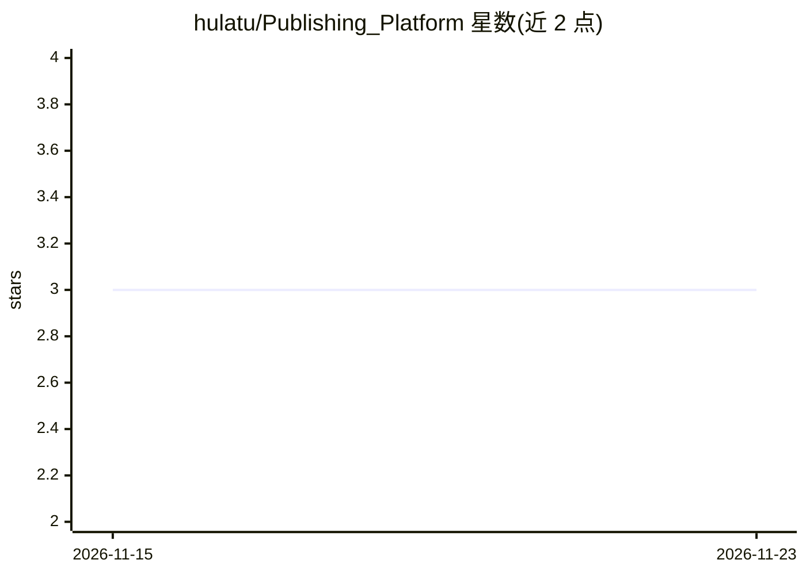

# hulatu/Publishing_Platform

⭐ 3 · TypeScript · 推送 2026-11-22 · [GitHub](https://github.com/hulatu/Publishing_Platform) · [官网](https://publish.hulatu.com) · 个人维护 · 中文 README

**把一篇 Markdown 分发到 11 个平台的内容发布台**

纯前端静态站点：将一篇 Markdown 按目标平台形态转换——少数派/知乎输出 Markdown，公众号输出全内联样式 HTML（12 套主题），豆瓣/B站/头条/百家号输出清洗后的富文本；小红书/推特/即刻/微博走两段式 AI 改写（先按 `##` 切节出可手改摘要，再按平台重写）并配 3:4 等比例配图卡片。AI 部分需自备 Key，不填 Key 时四个平台退回本地组装。附图片体检/导出、合规检查、草稿箱与互动率复盘。部署到 Cloudflare Pages。

## 筛选速览

| 维度 | 判定 | 备注 |
|---|---|---|
| AI 角色 | `ai-enhanced` | 去掉 AI 部分产品仍成立 |
| 许可风险 | `none` | — |
| 部署形态 | `library` | 以包/库形式分发 |
| 模型依赖 | — | README 未给出锁定关系 |
| 硬件要求 | — | 无带数字的原话,不猜 |
| 安装摩擦 | `low` | 无编译、无系统依赖或容器化 |
| 成熟度 | — | 结构信号不足 |

## 能力要点

- 7 个平台确定性转换 + 4 个平台两段式 AI 改写，转换路径可复现
- 12 套公众号排版主题，输出全内联样式 HTML
- 按小节生成配图卡片，九种版式、三种比例
- 无服务端架构，合规检查本地词表+正则不联网

## 适用场景

- 把博客文章复制粘贴分发到公众号、知乎等多个平台
- 为小红书/微博等平台生成符合字数限制的短文案和配图卡片
- 发布前检查图片可用性并按平台导出合规尺寸

## 场景标签

`AI 写作` · 领域:内容生成

## 证据(README 行号)

> L47: 前两类是**确定性转换**（不调用大模型、秒出、可复现），第三类是**大模型改写**。
> L113: 不填 Key 也能走完这三步：7 个平台是纯格式转换，另外 4 个走本地抽取（界面会标「本地组装」，
> L61: |🧩|**11 个平台开箱即用**|7 个确定性转换 + 4 个 AI 改写，另加配图卡片工坊|

## 星数曲线

2026-11-15 3 → 2026-11-23 3（+0）

---
*卡片 v1 · prompt 1.4 · 生成 2026-11-21 · 置信度 high · 依据 README sha `23f79f94b897` · [字段定义](../../DATASET.md)*
