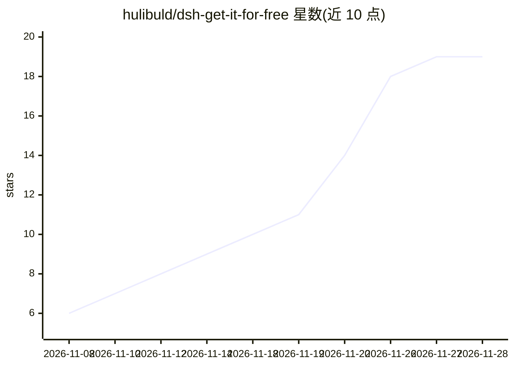

# hulibuld/dsh-get-it-for-free

⭐ 19 · JavaScript · MIT · 推送 2026-11-27 · [GitHub](https://github.com/hulibuld/dsh-get-it-for-free) · [官网](https://www.npmjs.com/package/dsh-get-it-for-free) · 个人维护 · 中文 README

**把免费/签到型大模型账号渠道接入 DeepSeek Harness 的插件**

以 DeepSeek Harness 插件形式运行的渠道接入器：管理华为云 CodeArts、腾讯 CodeBuddy、Qoder、TRAE、Raccoon、MiniMax、豆包工作等 11 个需登录的账号渠道，负责登录态保存、每日/自动签到、模型池定时探测与按 provider 注册。仅提供登录自有账号后可得的模型，纯本地运行、无遥测，凭据存于 ~/.dsh 目录。需 Node.js ^22.19.0 或 >=24、DSH 0.2.0-rc.1 以上。另提供本机 OpenAI 兼容 API 网关与用量看板。

## 筛选速览

| 维度 | 判定 | 备注 |
|---|---|---|
| AI 角色 | `ai-ecosystem` | LLM/agent 周边工具 |
| 许可风险 | `permissive` | MIT |
| 部署形态 | `library` | 以包/库形式分发 |
| 模型依赖 | locked-api |  |
| 硬件要求 | — | 无带数字的原话,不猜 |
| 安装摩擦 | `low` | 无编译、无系统依赖或容器化 |
| 成熟度 | — | 结构信号不足 |

## 能力要点

- 11 个账号渠道的登录、签到、令牌续期与账号看板管理
- 模型池定时探测并按可用/区域受限注册为 provider，目录变更 diff 同步
- 本机 OpenAI 兼容 API 网关（127.0.0.1:8326，/v1/models、/v1/chat/completions、/v1/responses）
- 3.3.0 起移除免登录车道，只保留自有账号渠道

## 适用场景

- 用自己在各平台的免费/积分账号为 DSH 增加可选模型
- 自动完成各渠道每日签到并跟踪积分与额度
- 把多个免费渠道统一成一个 OpenAI 兼容本地端点供其他客户端使用

## 场景标签

`模型网关` `工作流自动化` · 领域:Agent 开发

## 证据(README 行号)

> L9: 把免费、签到型的大模型账号渠道接进 DeepSeek。设置里登录账号、每日签到、同步可用模型池，模型以普通 provider 的形式出现在模型选择器里。
> L50: 插件按 profile 方式装。把插件目录放进 profile 的 `node_modules`，在 `package.json` 的 `dsh.profile.bundles` 里加 `dsh-get-it-for-free`，

## 星数曲线

2026-11-08 6 → 2026-11-28 19（+13）

---
*卡片 v1 · prompt 1.4 · 生成 2026-11-19 · 置信度 high · 依据 README sha `8f56956c073d` · [字段定义](../../DATASET.md)*
