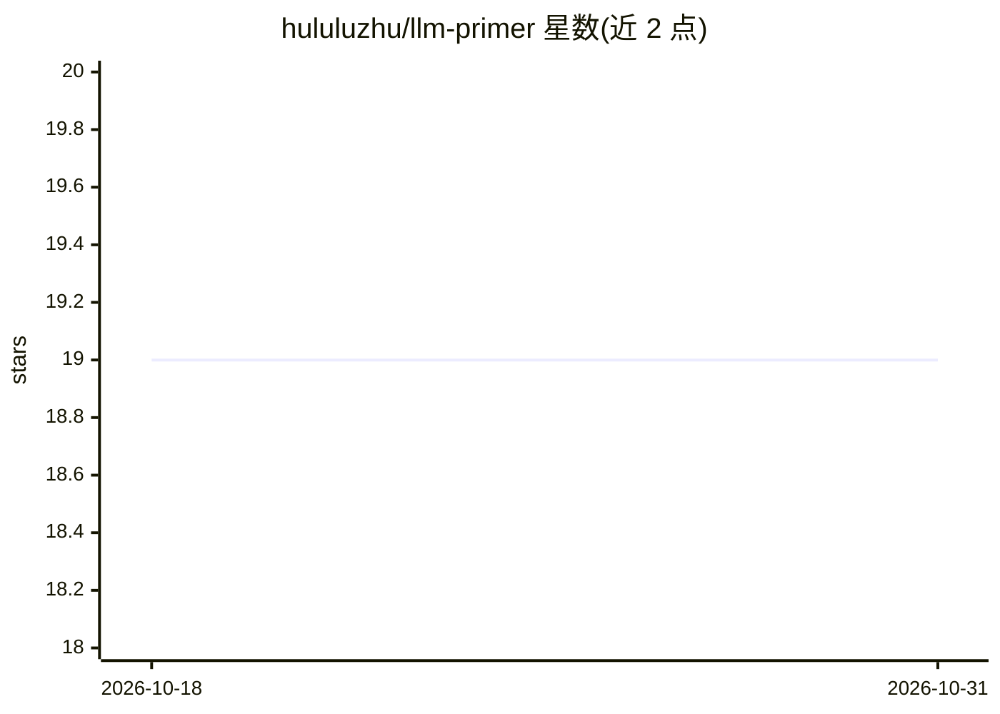

# hululuzhu/llm-primer

⭐ 19 · Apache-2.0 · 推送 2026-07-17 · [GitHub](https://github.com/hululuzhu/llm-primer) · 个人维护 · 中文 README

**LLM 入门教程幻灯集：讲解 LLM 基础与 ChatGPT 原理**

个人维护的大语言模型入门教程仓库，以多版本幻灯片（V1 2022.7 / V2 2023.1 / V2.1 2023.4）和草稿笔记形式组织，内容覆盖 Transformer、LLM 训练与解码、BERT/GPT/T5/GLM 等代表模型、Scaling laws、提示工程、RLHF、MoE、检索式 LLM、HuggingFace 等工具链，以及 ChatGPT 深度专题（InstructGPT、训练/服务成本估算、复现难点讨论）。附约 120 篇参考文献列表与推荐阅读，含中文专题笔记，另有视频录像和面向谷雨书苑的特别版本。仓库为静态资料，不含可安装代码。

## 筛选速览

| 维度 | 判定 | 备注 |
|---|---|---|
| AI 角色 | `ai-knowledge` | 知识聚合/清单类 |
| 许可风险 | `permissive` | Apache-2.0 |
| 部署形态 | `None` |  |
| 模型依赖 | — | README 未给出锁定关系 |
| 硬件要求 | — | 无带数字的原话,不猜 |
| 安装摩擦 | `low` | 无编译、无系统依赖或容器化 |
| 成熟度 | — | 结构信号不足 |

## 能力要点

- V1–V2.1 多版本幻灯片覆盖 LLM 基础、模型谱系与工具链
- ChatGPT 深度专题：InstructGPT 概览、成本估算与复现难点思考
- 约 120 篇参考文献与推荐阅读（含中文来源）
- 带 AI 辅助的 V2.1 幻灯片视频录像

## 适用场景

- 系统性学习 LLM 基础概念与代表模型
- 了解 ChatGPT 技术原理与训练成本讨论
- 按参考文献列表延伸阅读原始论文

## 场景标签

`教程课程` · 领域:学习与行业

## 证据(README 行号)

> L2: A primer on large language models (LLM) and ChatGPT as of April 2023
> L11:  Intro: Building blocks & capabilities
> L49:  Bonus: Deep dive into ChatGPT

## 星数曲线

2026-10-18 19 → 2026-10-31 19（+0）

---
*卡片 v1 · prompt 1.4 · 生成 2026-10-28 · 置信度 high · 依据 README sha `dd1d444bd0d9` · [字段定义](../../DATASET.md)*
