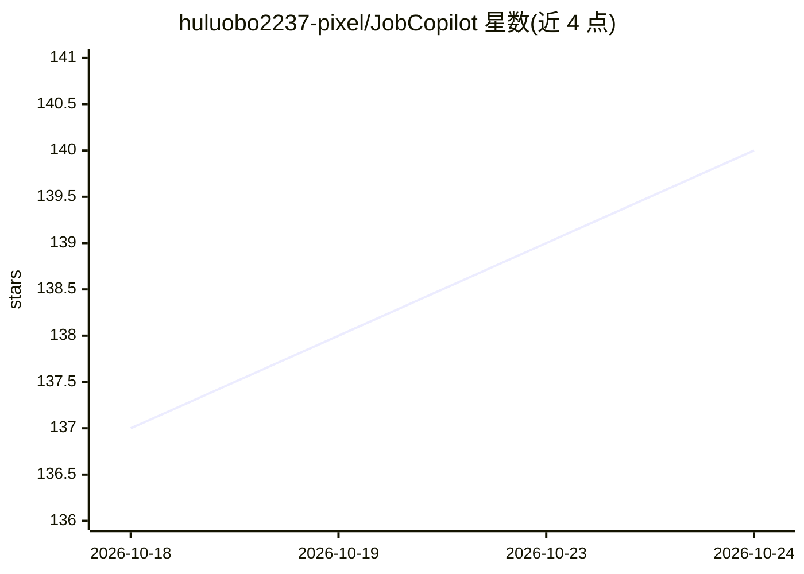

# huluobo2237-pixel/JobCopilot

⭐ 141 · JavaScript · MIT · 推送 2026-06-18 · [GitHub](https://github.com/huluobo2237-pixel/JobCopilot) · 个人维护 · 中文 README

**BOSS 直聘自动投递浏览器扩展：AI 筛岗位并生成招呼语**

Edge/Chrome 浏览器扩展（Manifest V3，原生 JavaScript），面向 BOSS 直聘平台的海投自动化：按关键词/城市/行业抓取岗位，调用 DeepSeek（deepseek-chat）结合用户简历做岗位匹配筛选，逐个岗位生成定制招呼语，经人工勾选确认后自动建立联系、发送简历图片与招呼语，带随机延迟与去重的拟人化投递节奏及实时日志面板。需用户自行配置 DeepSeek API Key 与简历材料。README 免责声明指出自动化操作可能违反平台用户协议。

## 筛选速览

| 维度 | 判定 | 备注 |
|---|---|---|
| AI 角色 | `ai-native` | 本体是模型或模型工具 |
| 许可风险 | `permissive` | MIT |
| 部署形态 | `None` |  |
| 模型依赖 | locked-api |  |
| 硬件要求 | — | 无带数字的原话,不猜 |
| 安装摩擦 | `low` | 无编译、无系统依赖或容器化 |
| 成熟度 | — | 结构信号不足 |

## 能力要点

- DeepSeek 结合简历做岗位筛选，剔除不匹配岗位
- 每个岗位基于 JD 与简历单独生成招呼语
- 投递前人工审核勾选确认机制
- 随机延迟、逐个投递、已投去重

## 适用场景

- 海投前自动收集并筛掉不匹配的岗位
- 为每个岗位生成针对性招呼语，减少复制粘贴
- 投递过程中通过日志面板掌握进度并随时暂停

## 场景标签

`浏览器自动化` `AI 写作` · 领域:效率与自动化

## 证据(README 行号)

> L27: - 🤖 **AI 智能筛选**：DeepSeek 结合你的简历，自动剔除不匹配/超纲岗位，只投够得着的
> L87: - **AI 模型**：DeepSeek（`deepseek-chat`）做岗位筛选与招呼语生成

## 星数曲线

2026-10-18 137 → 2026-10-24 140（+3）

---
*卡片 v1 · prompt 1.4 · 生成 2026-10-22 · 置信度 high · 依据 README sha `17492084d5d0` · [字段定义](../../DATASET.md)*
