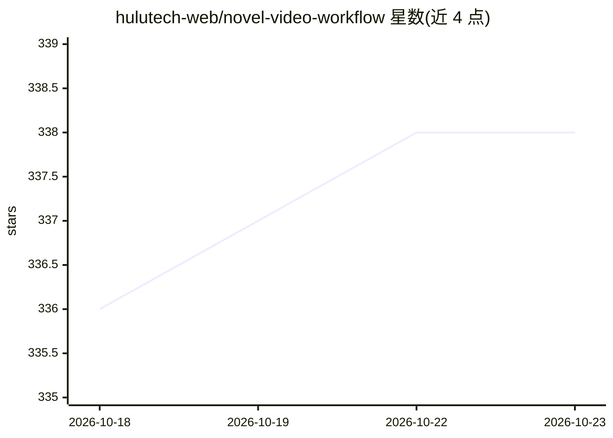

# hulutech-web/novel-video-workflow

⭐ 338 · Go · 推送 2026-04-12 · [GitHub](https://github.com/hulutech-web/novel-video-workflow) · [官网](https://yadou.net) · 组织维护 · 中文 README

**本地 AI 小说转视频工作流：章节分割、配音字幕图像到剪映草稿**

基于 Go 的完全本地化小说转视频自动化系统：读取小说文本，自动按章节分割（支持中英文数字章节、最多 99 章），调用 Ollama 做 AI 推理、IndexTTS2 生成配音（支持声音克隆参考音频）、DrawThings 生成章节图像，输出音频、SRT 字幕、图像及可直接导入剪映的项目草稿文件。提供 Web 控制台（localhost:8080）、MCP 服务（可集成 Ollama Desktop 等代理平台）与命令行批量处理三种使用方式。系统要求 macOS + Apple Silicon（Metal）、16GB 以上内存，依赖 Ollama/DrawThings/IndexTTS2/Aegisub/FFmpeg 等本地服务，启动时自检任一必需服务缺失即停止。

## 筛选速览

| 维度 | 判定 | 备注 |
|---|---|---|
| AI 角色 | `ai-native` | 本体是模型或模型工具 |
| 许可风险 | `none` | — |
| 部署形态 | `None` |  |
| 模型依赖 | local-ok | 支持本地模型 |
| 硬件要求 | — | 无带数字的原话,不猜 |
| 安装摩擦 | `medium` | 含编译或系统依赖之一 |
| 成熟度 | — | 结构信号不足 |

## 能力要点

- 小说→章节分割→TTS 配音→字幕→AI 图像的端到端工作流
- 生成可直接导入剪映的一键出片项目草稿
- 实现 MCP 协议，提供 9 个 MCP 工具并支持 Ollama Desktop 集成
- 新增歌词生成 MV 图像功能（generate_image_from_lyric_ai_prompt）

## 适用场景

- 把小说文本自动转成带配音字幕图像的视频并导入剪映剪辑
- 通过 Ollama Desktop 等 AI 代理以 MCP 调用生成工具
- 根据歌词自动生成 MV 图像

## 场景标签

`工作流自动化` `语音合成` `视频生成` · 领域:效率与自动化

## 证据(README 行号)

> L9: 一个基于AI技术的小说转视频自动化生成系统，集成了多种AI工具（TTS、图像生成等），能够将小说文本转换为带有音频、字幕和图像的视频内容，并生成可用于剪映的一键出片项目结构。
> L25: - 🎨 **AI图像生成** - 基于章节内容的智能图像生成
> L27: - 🔌 **MCP服务集成** - 与Ollama Desktop等AI代理平台集成

## 星数曲线

2026-10-18 336 → 2026-10-23 338（+2）

---
*卡片 v1 · prompt 1.4 · 生成 2026-10-21 · 置信度 high · 依据 README sha `c20823029928` · [字段定义](../../DATASET.md)*
