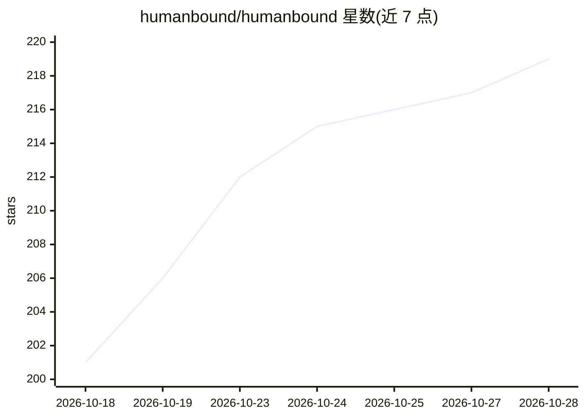

# humanbound/humanbound

⭐ 219 · Python · Apache-2.0 · 推送 2026-10-27 · [GitHub](https://github.com/humanbound/humanbound) · [官网](https://docs.humanbound.ai/) · 组织维护

**AI agent 的对抗性测试引擎、SDK 与 CLI，可本地运行**

面向 AI agent 的红队测试工具：以多轮对话驱动真实端点，探测工具滥用与权限边界，并按用户声明的安全策略（scope.yaml）评分；测试发现的失败可经 hb guardrails 转换为防火墙规则，部署到 humanbound-firewall。以 pip 包提供 CLI 与 Python SDK（共享同一实现），可用 OpenAI/Anthropic/Gemini/Ollama 作为引擎 provider，支持 Ollama 完全离线运行；也可对接 Humanbound Platform 或在 Docker 中运行故意脆弱的 arena agent 练习。Apache-2.0 许可，CLI 默认发送匿名遥测，可关闭。

## 筛选速览

| 维度 | 判定 | 备注 |
|---|---|---|
| AI 角色 | `ai-ecosystem` | LLM/agent 周边工具 |
| 许可风险 | `permissive` | Apache-2.0 |
| 部署形态 | `self-host` | docker 或自建部署 |
| 模型依赖 | local-ok | 支持本地模型 |
| 硬件要求 | — | 无带数字的原话,不猜 |
| 安装摩擦 | `low` | 无编译、无系统依赖或容器化 |
| 成熟度 | — | 结构信号不足 |

## 能力要点

- 多轮对话对抗测试真实 agent 端点，按 scope.yaml 安全策略评分
- hb guardrails 将测试发现转换为可部署的防火墙规则
- 支持 OpenAI/Anthropic/Gemini/Ollama 引擎，可经 Ollama 完全离线运行
- CLI 与 SDK 共享同一实现，含 MCP server 入口

## 适用场景

- 上线前对 agent 做越狱与工具滥用攻击测试
- 把测试发现的失败项转换为防火墙规则加固 agent
- 离线环境下用 Ollama 引擎做对抗测试

## 场景标签

`网络安全` `模型评测` · 领域:评测与运维

## 证据(README 行号)

> L5:  Open-source adversarial testing engine, SDK, and CLI for AI agents.
> L31: Most testing tools test prompts. Humanbound tests **agents**: it drives
> L34: fail, `hb guardrails` converts the findings into deployable firewall rules —

## 星数曲线

2026-10-18 201 → 2026-10-28 219（+18）

---
*卡片 v1 · prompt 1.4 · 生成 2026-10-22 · 置信度 high · 依据 README sha `d2fe8df3c821` · [字段定义](../../DATASET.md)*
