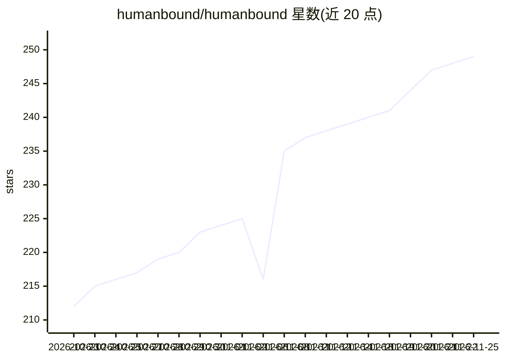

# humanbound/humanbound

⭐ 249 · Python · Apache-2.0 · 推送 2026-11-23 · [GitHub](https://github.com/humanbound/humanbound) · [官网](https://docs.humanbound.ai/) · 组织维护

**AI agent 的对抗性安全测试引擎、SDK 与 CLI**

面向 AI agent 的开源安全测试工具：通过多轮对话对真实端点发起 prompt injection、jailbreak、工具滥用等攻击，由 AI judge 依据安全策略逐条评分，产出 0–100 分与 A–F 等级的安全分、失败会话清单及映射到 OWASP LLM/Agentic AI Top 10 的 findings；findings 可导出为 humanbound-firewall 的防火墙规则。提供 CLI、Python SDK、GitHub Action 与 MCP server，可本地运行或连接 Humanbound Platform 使用托管攻击模型。仅可测试自有或获授权的 agent。

## 筛选速览

| 维度 | 判定 | 备注 |
|---|---|---|
| AI 角色 | `ai-ecosystem` | LLM/agent 周边工具 |
| 许可风险 | `permissive` | Apache-2.0 |
| 部署形态 | `library` | 以包/库形式分发 |
| 模型依赖 | local-ok | 支持本地模型 |
| 硬件要求 | — | 无带数字的原话,不猜 |
| 安装摩擦 | `low` | 无编译、无系统依赖或容器化 |
| 成熟度 | — | 结构信号不足 |

## 能力要点

- 多轮对话式攻击（prompt injection、jailbreak、工具滥用、数据泄露）并由 AI judge 逐轮评分
- 0–100 安全分与 A–F 等级，findings 映射 OWASP LLM/Agentic AI Top 10
- findings 可导出为防火墙策略并加载到 humanbound-firewall
- 支持 CLI、Python SDK、GitHub Action 与 MCP server 四种使用方式

## 适用场景

- 上线前对自有 agent 做红队测试
- 在每个 pull request 中检测 prompt/工具/模型变更引入的安全问题
- 将失败 findings 转为防火墙规则在运行时拦截同类攻击

## 场景标签

`网络安全` `模型评测` · 领域:评测与运维

## 证据(README 行号)

> L24: Humanbound tests **the agent, not just the prompt**: it holds multi-turn conversations with
> L37: - **Fits your workflow** — CLI, Python SDK, GitHub Action and an MCP server for coding agents
> L48: - **In production** — monitor the agent continuously and catch regressions (Platform)

## 星数曲线

2026-10-23 212 → 2026-11-25 249（+37）

---
*卡片 v1 · prompt 1.4 · 生成 2026-11-25 · 置信度 high · 依据 README sha `60a8ce741ac8` · [字段定义](../../DATASET.md)*
