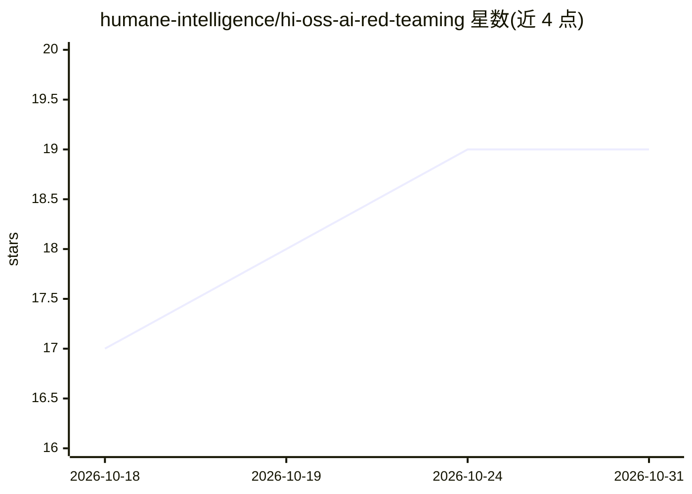

# humane-intelligence/hi-oss-ai-red-teaming

⭐ 19 · Python · Apache-2.0 · 推送 2026-10-22 · [GitHub](https://github.com/humane-intelligence/hi-oss-ai-red-teaming) · [官网](https://humane-intelligence.org) · 组织维护

**面向人类红队测试的 AI 模型评测平台（Web 应用）**

由 Humane Intelligence 维护的 Web 应用，用于对 AI 模型或系统开展以人为中心的红队测试：连接人类红队成员与被测模型，注册模型端点与凭证（密钥加密存储、SSE 流式返回），按评估组→评估→场景→任务的结构组织测试，完整记录对话、消息级标记与评审结论，并附审计日志、RBAC 权限与导出/仪表盘。Monorepo：Python/FastAPI 后端 + React/Vite 前端，依赖 Docker、make、uv 运行。免责声明要求部署者自行制定服务条款与数据处理协议。Apache 2.0 许可。

## 筛选速览

| 维度 | 判定 | 备注 |
|---|---|---|
| AI 角色 | `ai-ecosystem` | LLM/agent 周边工具 |
| 许可风险 | `permissive` | Apache-2.0 |
| 部署形态 | `None` |  |
| 模型依赖 | — | README 未给出锁定关系 |
| 硬件要求 | — | 无带数字的原话,不猜 |
| 安装摩擦 | `low` | 无编译、无系统依赖或容器化 |
| 成熟度 | — | 结构信号不足 |

## 能力要点

- 单适配器接入任意模型提供商，红队成员无需接触 API key，密钥静态加密
- 评估组→评估→场景→任务结构与发布生命周期（draft→approved→published）
- 完整对话记录、消息级标记、评审结论与 append-only 审计日志
- 全局+对象级 RBAC 与异步导出、指标仪表盘

## 适用场景

- 组织人类红队成员对 AI 模型开展安全性测试
- 管理评估全流程并生成可复核的测试记录
- 对整场评测活动导出数据并查看指标看板

## 场景标签

`模型评测` · 领域:评测与运维

## 证据(README 行号)

> L17: This software is a web application designed to red team AI models or systems. AI red teaming is a
> L20: platform is the software to connect human red teamers with the AI models and systems, and keep the
> L50: The host needs Docker, make, and uv — uv provisions Python and runs the

## 星数曲线

2026-10-18 17 → 2026-10-31 19（+2）

---
*卡片 v1 · prompt 1.4 · 生成 2026-10-28 · 置信度 high · 依据 README sha `0bd7d7b65bf0` · [字段定义](../../DATASET.md)*
