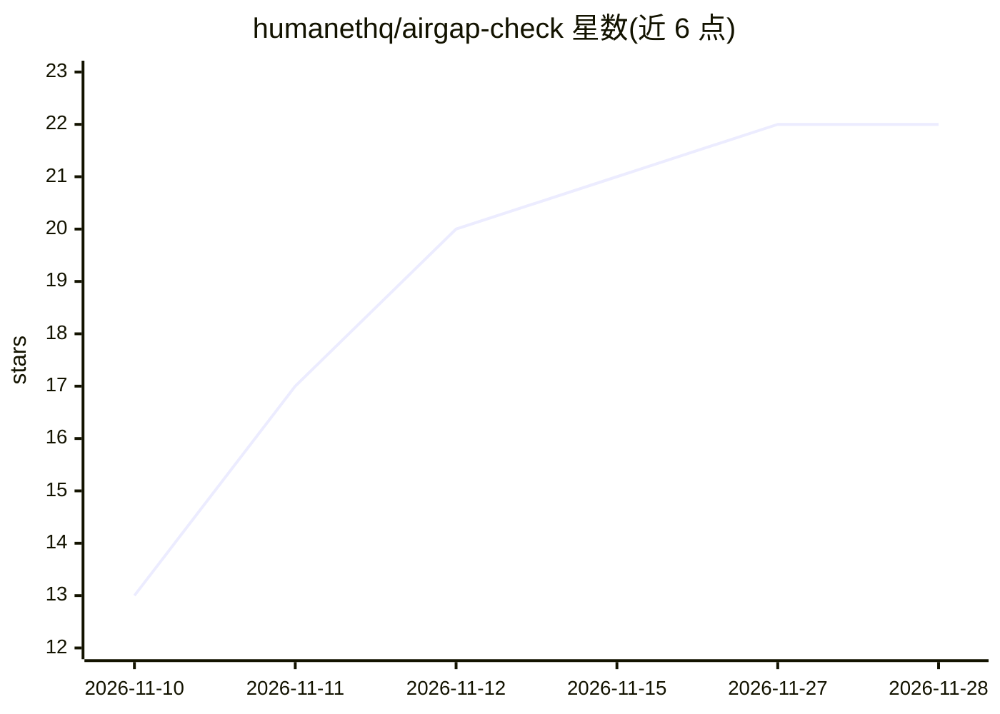

# humanethq/airgap-check

⭐ 22 · Go · MIT · 推送 2026-11-11 · [GitHub](https://github.com/humanethq/airgap-check) · 组织维护

**审计 AI 应用离线场景下崩溃与静默外联的 Go CLI 工具**

面向在气隙/离线网络（医院、防务 VPC、无网容器）部署 AI 应用的开发者：通过静态扫描清单与锁文件、源码模式匹配（nltk.download、from_pretrained、tiktoken 等运行时下载调用）以及 `docker run --network none` 动态探测，暴露首次使用时的模型/语料/遥测下载、静默外联与 .env 密钥路由问题；`--fix` 输出环境变量修复建议。仅用 Go 标准库，--run 需要 Docker；loopback sinkhole 仅在 Python/Node 容器中单独验证。

## 筛选速览

| 维度 | 判定 | 备注 |
|---|---|---|
| AI 角色 | `ai-ecosystem` | LLM/agent 周边工具 |
| 许可风险 | `permissive` | MIT |
| 部署形态 | `self-host` | docker 或自建部署 |
| 模型依赖 | — | README 未给出锁定关系 |
| 硬件要求 | — | 无带数字的原话,不猜 |
| 安装摩擦 | `low` | 无编译、无系统依赖或容器化 |
| 成熟度 | — | 结构信号不足 |

## 能力要点

- 静态扫描多语言清单与锁文件，识别运行时下载与遥测调用
- docker run --network none 动态探测，loopback DNS/TLS/HTTP sinkhole 捕获出站目标
- --fix 输出 Dockerfile ENV 禁用遥测与预热建议
- .env 密钥仅分类键名，不读取不记录值

## 适用场景

- 部署到气隙网络前排查 AI 应用会联网下载什么
- 发现首次使用时因 tokenizer/模型下载导致的离线崩溃
- 检测应用中未声明的遥测外联行为

## 场景标签

`网络安全` · 领域:学习与行业

## 证据(README 行号)

> L3: Find out what your AI app downloads, or tries to reach, when the network goes away.
> L9: A common assumption: point the LLM base URL at a local vLLM or Ollama instance and the app is ready for an offline n

## 星数曲线

2026-11-10 13 → 2026-11-28 22（+9）

---
*卡片 v1 · prompt 1.4 · 生成 2026-11-18 · 置信度 mid · 依据 README sha `1f4af7dc183f` · [字段定义](../../DATASET.md)*
