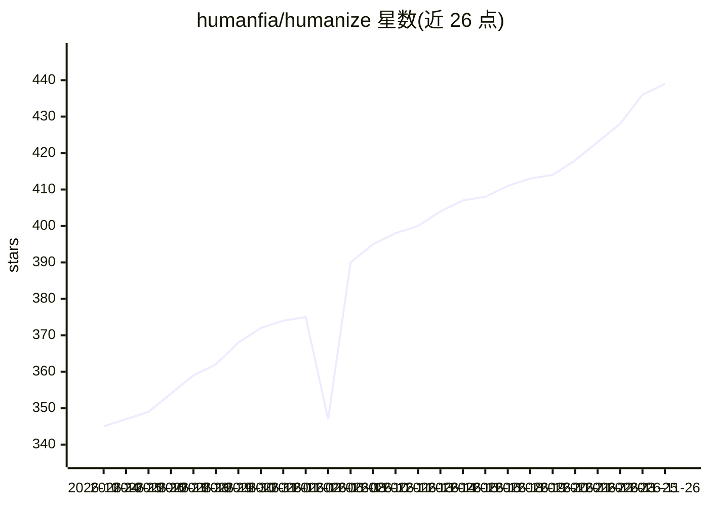

# humanfia/humanize

⭐ 439 · Python · Apache-2.0 · 推送 2026-11-25 · [GitHub](https://github.com/humanfia/humanize) · [官网](https://humanfia.ai/humanize/) · 个人维护

**面向编码 agent 的流程编排系统，按预算运行任务流**

Humanize（hmz）是一个编码 agent 的流程编排工具：在仓库内的终端或浏览器界面中，通过 /flow 命令启动预定义的 agent 流程，并以成本预算参数约束运行，例如让 agent 迭代直至测试通过。它本身不内置任何流程，需从官方 flowverse 安装或自行编写。需要 Python 3.12+、uv 以及一个已登录的编码 agent CLI（如 Claude Code 或 Codex）。提供 macOS/Windows 桌面安装包、uv 安装的 CLI、以及 hmz exec/web/chat 等命令行用法。

## 筛选速览

| 维度 | 判定 | 备注 |
|---|---|---|
| AI 角色 | `ai-ecosystem` | LLM/agent 周边工具 |
| 许可风险 | `permissive` | Apache-2.0 |
| 部署形态 | `desktop` | 安装包/桌面程序 |
| 模型依赖 | — | README 未给出锁定关系 |
| 硬件要求 | — | 无带数字的原话,不猜 |
| 安装摩擦 | `low` | 无编译、无系统依赖或容器化 |
| 成熟度 | — | 结构信号不足 |

## 能力要点

- 通过 flow 定义并以预算参数（如 budget.cost）运行编码 agent 任务
- 官方 flowverse 提供可安装的流程，也可自写
- 支持 Claude Code、Codex 等已登录的编码 agent CLI 作为后端
- 提供桌面端（macOS/Windows）、CLI 与 hmz web 浏览器界面

## 适用场景

- 用固定流程迭代驱动编码 agent 直至测试通过
- 为 agent 任务设置成本预算以防 token 开销失控
- 在终端或浏览器中统一管理仓库内的 agent 会话

## 场景标签

`编码 Agent` `Agent 框架` · 领域:Agent 开发

## 证据(README 行号)

> L46: Open the terminal interface in a repository, on a chat with your coding agent; `$<flow>` or
> L70: hmz exec -f ralph_loop -a agent=claude/claude-opus-5:high -p budget.cost=5 "Make the tests pass"

## 星数曲线

2026-10-24 345 → 2026-11-26 439（+94）

---
*卡片 v1 · prompt 1.4 · 生成 2026-11-25 · 置信度 mid · 依据 README sha `96eabf36bbd4` · [字段定义](../../DATASET.md)*
