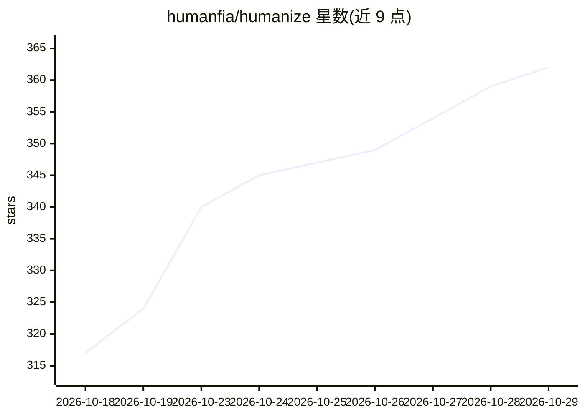

# humanfia/humanize

⭐ 362 · Python · Apache-2.0 · 推送 2026-10-25 · [GitHub](https://github.com/humanfia/humanize) · [官网](https://docs.humanfia.ai/humanize/) · 组织维护

**让多 CLI 编码 agent 按流程编排运行的系统**

Python 实现的 agent flow 系统：用户在终端（hmz）、浏览器（hmz web）或 shell（hmz exec -f）中运行由编码 agent 组成的流程，以单一任务命令指定模型（如 claude-opus）。支持接入多种后端 CLI：Claude Code、Codex、DeepSeek Harness、Kimi Code，以及通过 litellm 调用模型。安装依赖 Python 3.12+、uv 与已登录的编码 agent CLI；macOS 提供将 hmz web 装入窗口的桌面 dmg。运行时审批默认旁路，文档建议在临时仓库中开始。

## 筛选速览

| 维度 | 判定 | 备注 |
|---|---|---|
| AI 角色 | `ai-ecosystem` | LLM/agent 周边工具 |
| 许可风险 | `permissive` | Apache-2.0 |
| 部署形态 | `desktop` | 安装包/桌面程序 |
| 模型依赖 | — | README 未给出锁定关系 |
| 硬件要求 | — | 无带数字的原话,不猜 |
| 安装摩擦 | `low` | 无编译、无系统依赖或容器化 |
| 成熟度 | — | 结构信号不足 |

## 能力要点

- 终端/浏览器/shell 三种方式运行 agent 流程
- 多后端支持：Claude Code、Codex、DeepSeek Harness、Kimi Code、litellm
- uv tool install 安装，hmz update 保留 extras 升级
- macOS dmg 桌面应用承载 hmz web

## 适用场景

- 在仓库里以流程方式驱动编码 agent 完成任务
- 跨多个 agent CLI 后端统一编排工作流
- 用浏览器集中查看本机所有 epic

## 场景标签

`编码 Agent` `Agent 框架` `多智能体` · 领域:Agent 开发

## 证据(README 行号)

> L5: The agent flow system for token maxxing.
> L16: Three backends need a package of their own: `[dsh]` for DeepSeek Harness, `[kimi]` for Kimi

## 星数曲线

2026-10-18 317 → 2026-10-29 362（+45）

---
*卡片 v1 · prompt 1.4 · 生成 2026-10-22 · 置信度 high · 依据 README sha `c4a9d871cfbb` · [字段定义](../../DATASET.md)*
