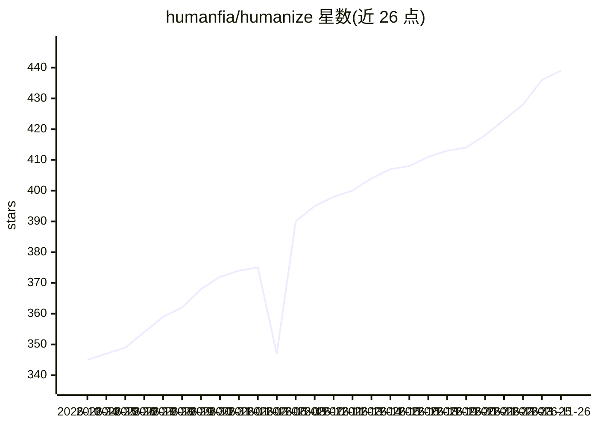

# humanfia/humanize

⭐ 439 · Python · Apache-2.0 · 推送 2026-11-25 · [GitHub](https://github.com/humanfia/humanize) · [官网](https://humanfia.ai/humanize/) · 个人维护

**给 coding agent 流程做调度与预算管理的运行时基础设施**

Humanize (hmz) 是一个 agent 流程运行基础设施：它本身不提供流程（flow），而是承载 flow 运行——调度多个 nous（harness + 账号 + 模型 + effort 组合），为每个 agent 在本机、SSH、容器或集群分配工作环境，统一管控运行预算，并保留可恢复、可追溯的运行记录。提供 CLI 与 Desktop 两种形态，需 Python 3.12+、uv 和一个已登录的 coding agent CLI（如 Claude Code 或 Codex）。支持通过 extras 安装 DeepSeek Harness、Kimi Code、litellm 后端。

## 筛选速览

| 维度 | 判定 | 备注 |
|---|---|---|
| AI 角色 | `ai-ecosystem` | LLM/agent 周边工具 |
| 许可风险 | `permissive` | Apache-2.0 |
| 部署形态 | `desktop` | 安装包/桌面程序 |
| 模型依赖 | — | README 未给出锁定关系 |
| 硬件要求 | — | 无带数字的原话,不猜 |
| 安装摩擦 | `low` | 无编译、无系统依赖或容器化 |
| 成熟度 | — | 结构信号不足 |

## 能力要点

- 多 nous 调度：重试与跨 harness 回退，环境覆盖本机/SSH/容器/集群
- 统一预算管控（如 budget.cost）与可恢复、可追溯的运行记录
- CLI 与 Desktop 双形态，可经 skills add 将 hmz 注册为各 agent 的技能
- 流程本体不内置，可从 flowverse 安装或自行编写

## 适用场景

- 在固定成本预算下驱动多个 coding agent 完成大型任务
- 跨多台机器编排长时运行的 agent 流程并断点恢复
- 在同一界面切换 Claude Code、Codex 等 agent 会话与 flow

## 场景标签

`编码 Agent` `Agent 框架` · 领域:Agent 开发

## 证据(README 行号)

> L7: Humanize is infrastructure, not a flow. A flow is a Python program that says what to ask and of
> L17: done by one model in one session, so what Humanize is built around is the scheduling: many

## 星数曲线

2026-10-24 345 → 2026-11-26 439（+94）

---
*卡片 v1 · prompt 1.4 · 生成 2026-11-26 · 置信度 high · 依据 README sha `6231c6212a81` · [字段定义](../../DATASET.md)*
