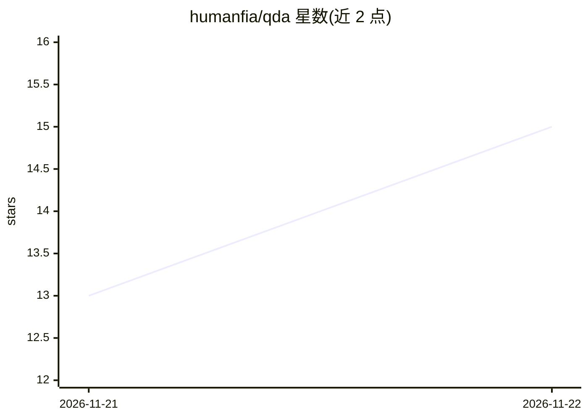

# humanfia/qda

⭐ 15 · Python · Apache-2.0 · 推送 2026-11-20 · [GitHub](https://github.com/humanfia/qda) · 组织维护

**让编码 Agent 为 LLM 设计量化配方并产出可部署检查点**

QDA 是一个 LLM 量化系统：编码 Agent 为每个模型与精度提出量化配方，QDA 构建配方并以 KL 散度在保留提示上评分，还检查长生成中的失败（如重复循环），选出符合比特预算的最优配方，输出的检查点可被 vLLM 或 llama.cpp 直接加载。需 Linux、NVIDIA GPU 与 uv；搜索 Agent 默认使用 Claude Code（也支持 Codex 与 DeepSeek），且未经确认即运行任务。项目发布 30 个检查点并附论文。

## 筛选速览

| 维度 | 判定 | 备注 |
|---|---|---|
| AI 角色 | `ai-ecosystem` | LLM/agent 周边工具 |
| 许可风险 | `permissive` | Apache-2.0 |
| 部署形态 | `library` | 以包/库形式分发 |
| 模型依赖 | local-ok | 支持本地模型 |
| 硬件要求 | — | 无带数字的原话,不猜 |
| 安装摩擦 | `medium` | 含编译或系统依赖之一 |
| 成熟度 | — | 结构信号不足 |

## 能力要点

- Agent 提出配方，自动构建并以 KL 散度在保留提示上评分
- 输出检查点可由 vLLM/llama.cpp 直接加载，无需额外代码
- 发布 10 个模型的 30 个检查点（W4A16、W3A16、W4A8、W4A4、GGUF 五种格式）
- qda doctor 命令检查环境配置

## 适用场景

- 为特定模型自动搜索 4/3 比特量化配方
- 量化后的模型用 vLLM 或 llama.cpp 部署服务
- 复现已发布检查点对应的配方（recipe-inputs 数据集）

## 场景标签

`编码 Agent` `模型量化` · 领域:编码与开发

## 证据(README 行号)

> L7: **QDA** is a system for LLM quantization in which a coding agent designs the recipe for each model and precision.
> L11: that stock **vLLM** or **llama.cpp** loads with no extra code.
> L55: **Warning:** the search agent runs without asking for approval, and every job it starts runs under your user

## 星数曲线

2026-11-21 13 → 2026-11-22 15（+2）

---
*卡片 v1 · prompt 1.4 · 生成 2026-11-21 · 置信度 high · 依据 README sha `a75f119d4222` · [字段定义](../../DATASET.md)*
