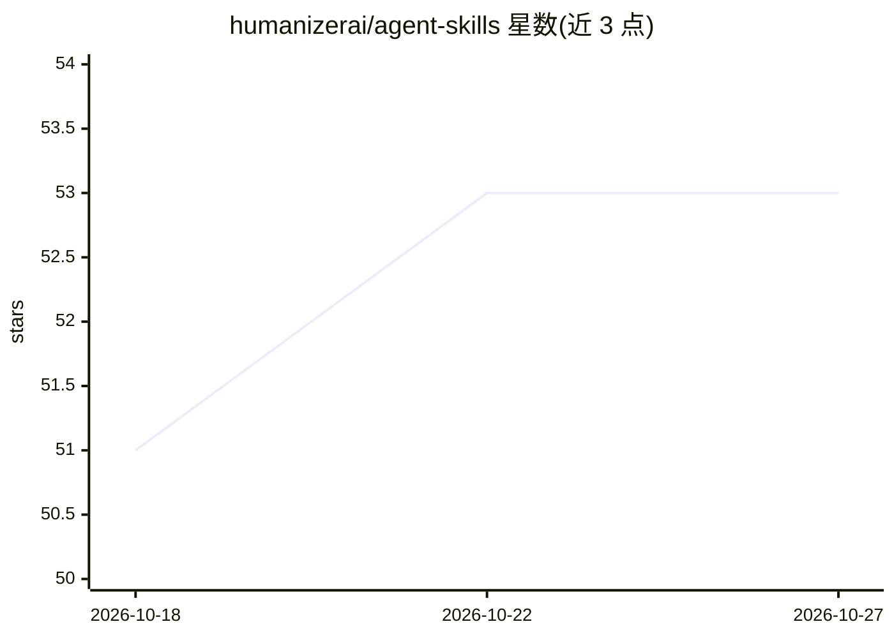

# humanizerai/agent-skills

⭐ 53 · MIT · 推送 2026-02-05 · [GitHub](https://github.com/humanizerai/agent-skills) · [官网](https://humanizerai.com) · 组织维护

**面向 Claude Code 等 Agent 的 AI 检测与文本拟人化技能集**

为 Claude Code、Cursor、Windsurf 等 Agent 安装的技能（skills）集合：/detect-ai 调用 HumanizerAI API 返回 0-100 的 AI 生成概率评分，/humanize 将 AI 文本改写为通过检测器的人类化文本（按词计费），另含冷邮件、跟进邮件、可读性分析等免费命令。humanize 提供三档改写强度，需注册 humanizerai.com 并订阅付费计划获取 API key，检测功能免费不限量。通过 npx 或手动复制到 .claude/skills 目录安装。

## 筛选速览

| 维度 | 判定 | 备注 |
|---|---|---|
| AI 角色 | `ai-native` | 本体是模型或模型工具 |
| 许可风险 | `permissive` | MIT |
| 部署形态 | `library` | 以包/库形式分发 |
| 模型依赖 | — | README 未给出锁定关系 |
| 硬件要求 | — | 无带数字的原话,不猜 |
| 安装摩擦 | `low` | 无编译、无系统依赖或容器化 |
| 成熟度 | — | 结构信号不足 |

## 能力要点

- /detect-ai 返回 0-100 AI 生成评分与详细指标
- /humanize 三档强度（light/medium/aggressive）改写文本
- 共 6 个命令：检测、拟人化、冷邮件、跟进邮件、可读性、字数统计
- 通过 npx skills add 一键安装到多种 Agent

## 适用场景

- 写作后先检测再拟人化处理，降低被 AI 检测器命中的概率
- 在 Claude Code 等 Agent 中直接调用文本检测与改写命令
- 分析文本可读性与字数统计

## 场景标签

`AI 写作` · 领域:内容生成

## 证据(README 行号)

> L3: AI detection and text humanization skills for Claude Code, Cursor, and other AI coding assistants.
> L11: |detect-ai|`/detect-ai`|Check if text is AI-generated|Free|
> L12: |humanize|`/humanize`|Make AI text undetectable|1 word = 1 credit|

## 星数曲线

2026-10-18 51 → 2026-10-27 53（+2）

---
*卡片 v1 · prompt 1.4 · 生成 2026-10-24 · 置信度 high · 依据 README sha `d75ed43aaefd` · [字段定义](../../DATASET.md)*
