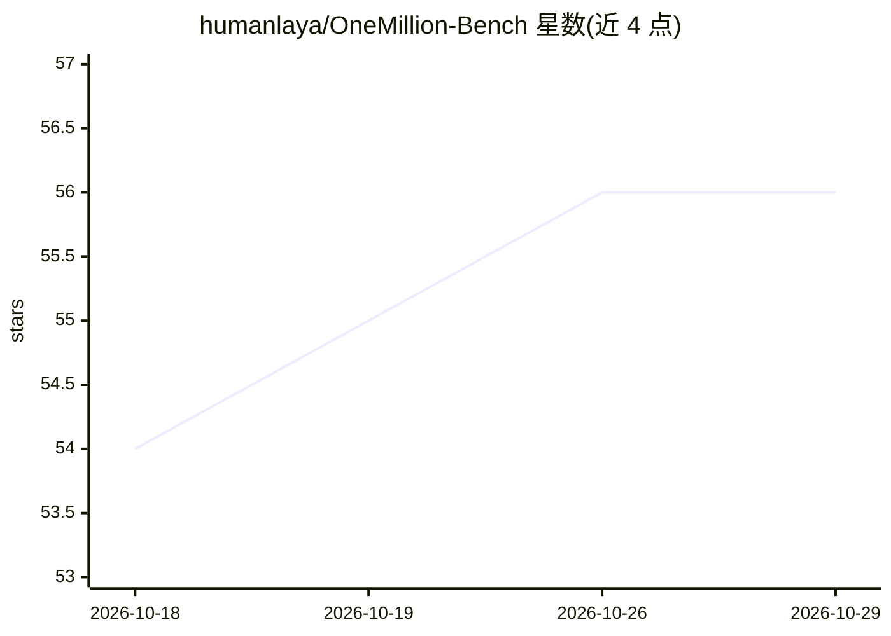

# humanlaya/OneMillion-Bench

⭐ 56 · Python · Apache-2.0 · 推送 2026-10-20 · [GitHub](https://github.com/humanlaya/OneMillion-Bench) · [官网](https://openreview.net/forum?id=2gAr3pMVHH) · 组织维护 · 中文 README

**语言 Agent 专业领域能力评测基准：数据集+CLI 工具+自动评分**

NeurIPS 2026 论文配套的评测工具与数据集：覆盖医疗、金融、工业、法律、自然科学 5 个专业领域，中英双语 400 题，每题含 5-23 条加权评分细则。CLI 工具 omb 生成 LLM agent 回答，用裁判模型按细则做二元判定并加权计分，支持 6 家 API 提供商接入 50+ 模型、最高 128 并发、重复采样、成本追踪，输出 Excel/JSON 报告；另可通过 EvalScope 以 OpenAI 兼容端点评测。需 Python 3.10+，数据集从 HuggingFace 下载。Apache 2.0 许可。

## 筛选速览

| 维度 | 判定 | 备注 |
|---|---|---|
| AI 角色 | `ai-ecosystem` | LLM/agent 周边工具 |
| 许可风险 | `permissive` | Apache-2.0 |
| 部署形态 | `library` | 以包/库形式分发 |
| 模型依赖 | locked-api |  |
| 硬件要求 | — | 无带数字的原话,不猜 |
| 安装摩擦 | `low` | 无编译、无系统依赖或容器化 |
| 成熟度 | — | 结构信号不足 |

## 能力要点

- 5 个专业领域、中英双语、400 题、每题 5-23 条加权 rubric
- CLI 工具 omb：生成回答、裁判模型二元评分、加权汇总
- 6 家提供商接入 50+ 模型，异步并发最高 128 并行请求
- 按模型追踪 token 用量与成本，输出 Excel/JSON 报告

## 适用场景

- 评测自家模型或 agent 系统在专业领域的表现
- 对比多个模型在医疗、法律、金融等任务上的得分与成本
- 用自定义 rubric 评测自有题目

## 场景标签

`模型评测` · 领域:评测与运维

## 证据(README 行号)

> L13: A rubric-based automated evaluation system for language agents capabilities on economically conceptual tasks across
> L33: $OneMillion-Bench is a CLI tool (`omb`) that generates LLM agent responses, grades them against weighted rubrics us
> L35: - **50+ models** across 6 providers (OpenRouter, Qwen/DashScope, VolcEngine, Hunyuan, Ling-1T, LiteLLM)

## 星数曲线

2026-10-18 54 → 2026-10-29 56（+2）

---
*卡片 v1 · prompt 1.4 · 生成 2026-10-24 · 置信度 mid · 依据 README sha `7e8c3a339976` · [字段定义](../../DATASET.md)*
