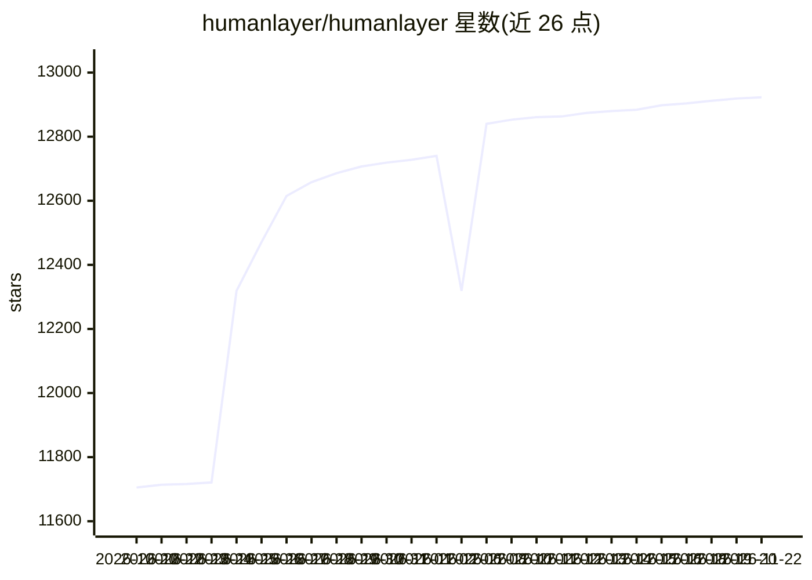

# humanlayer/humanlayer

⭐ 12,923 · TypeScript · Apache-2.0 · 推送 2026-11-16 · [GitHub](https://github.com/humanlayer/humanlayer) · [官网](https://humanlayer.dev/code) · 组织维护

**团队统一托管与协作编码 agent 的桌面/Web 平台**

在用户自己的机器上运行编码 agent（Claude Code、Codex、OpenCode、Pi），让团队从单一界面管理任务、会话、计划与评审，数据在桌面应用、Web 应用与各主机的 daemon 之间同步。仓库为 Turborepo monorepo，使用 Bun 构建，包含桌面端（Electron/Tauri）、daemon、CLI、API、管理后台等组件。源码构建不外发数据，遥测默认关闭；自托管提供参考 Pulumi 栈但声明非受支持安装。Apache 2.0 许可，部分 vendored 目录保留 MIT。

## 筛选速览

| 维度 | 判定 | 备注 |
|---|---|---|
| AI 角色 | `ai-ecosystem` | LLM/agent 周边工具 |
| 许可风险 | `permissive` | Apache-2.0 |
| 部署形态 | `self-host` | docker 或自建部署 |
| 模型依赖 | — | README 未给出锁定关系 |
| 硬件要求 | — | 无带数字的原话,不猜 |
| 安装摩擦 | `low` | 无编译、无系统依赖或容器化 |
| 成熟度 | — | 结构信号不足 |

## 能力要点

- 在本地主机运行多类编码 agent，桌面/Web/daemon 三端同步
- 插件将 Claude Code、OpenCode、Pi 会话镜像到平台
- 提供 CLI（随附 daemon）与 self-host 参考栈（Pulumi + GitHub Actions）
- 源码构建时 Sentry/PostHog 等遥测默认关闭

## 适用场景

- 团队在同一界面分配并跟进多个编码 agent 任务
- 在自有主机上运行 agent 会话并做评审协作
- 参考提供的 Pulumi 栈自行部署整套服务

## 场景标签

`编码 Agent` · 领域:编码与开发

## 证据(README 行号)

> L3: HumanLayer runs coding agents (Claude Code, Codex, OpenCode, Pi) on your machines and lets your team steer them from
> L11: - `apps/riptide-daemon`: the daemon that runs agent sessions on a host

## 星数曲线

2026-10-20 11,705 → 2026-11-22 12,923（+1,218）

---
*卡片 v1 · prompt 1.4 · 生成 2026-11-22 · 置信度 mid · 依据 README sha `df8c7c8b9a45` · [字段定义](../../DATASET.md)*
