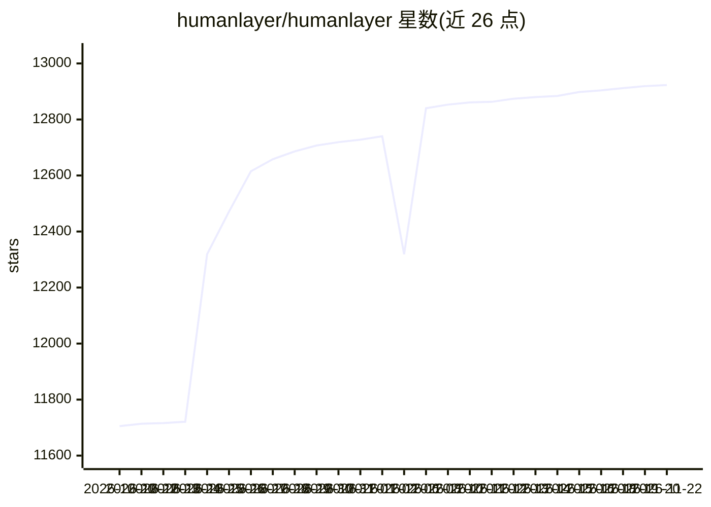

# humanlayer/humanlayer

⭐ 12,923 · TypeScript · Apache-2.0 · 推送 2026-11-16 · [GitHub](https://github.com/humanlayer/humanlayer) · [官网](https://humanlayer.dev/code) · 组织维护

**HumanLayer 的公开 issues 仓库，主体代码已弃用**

humanlayer 的 public issues 仓库，README 声明此处代码基本已全部弃用，并引导用户访问 https://humanlayer.com 尝试重建版本。仓库本身不提供可安装或运行的功能说明，无安装命令、无功能描述、无使用文档；从仓库主题标签可见原项目与 AI coding agents、human-in-the-loop 审批相关。

## 筛选速览

| 维度 | 判定 | 备注 |
|---|---|---|
| AI 角色 | `ai-ecosystem` | LLM/agent 周边工具 |
| 许可风险 | `none` | Apache-2.0 |
| 部署形态 | `None` |  |
| 模型依赖 | — | README 未给出锁定关系 |
| 硬件要求 | — | 无带数字的原话,不猜 |
| 安装摩擦 | `low` | 无编译、无系统依赖或容器化 |
| 成熟度 | — | 结构信号不足 |

## 能力要点

- README 明确声明此处代码已弃用
- 指向 humanlayer.com 的重建版本
- 仓库用途为公开 issues 跟踪

## 适用场景

- 查阅 humanlayer 历史项目的 issue 记录
- 通过链接跳转至 humanlayer.com 了解重建版本

## 场景标签

 · 领域:AI 代理工具/开发基础设施

## 证据(README 行号)

> L1: ## HumanLayer
> L3: public issues repo for humanlayer - the code here is pretty much all deprecated - you can try the rebuild of humanla

## 星数曲线

2026-10-20 11,705 → 2026-11-22 12,923（+1,218）

---
*卡片 v1 · prompt 1.4 · 生成 2026-10-20 · 置信度 low · 依据 README sha `e2706b73b86d` · [字段定义](../../DATASET.md)*
