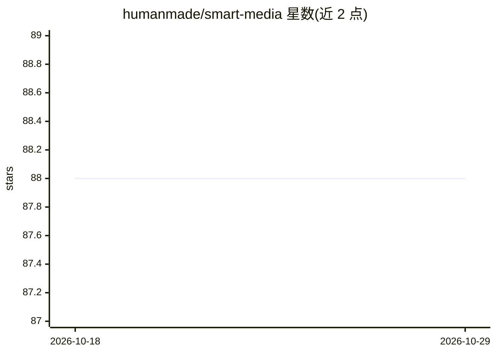

# humanmade/smart-media

⭐ 88 · PHP · 推送 2026-10-26 · [GitHub](https://github.com/humanmade/smart-media) · 组织维护

**WordPress 媒体库增强插件：改进图片浏览与裁剪编辑体验**

Human Made 维护的 WordPress 插件，为媒体库提供增强功能：保持原图宽高比缩略图（类似 Flickr 界面）替代默认方形缩略图，并替换内置图片编辑体验，支持对单个缩略图控制裁剪、减少编辑点击次数。裁剪 UI 提供与 Gutenberg 区块属性联动（选中图片更新区块属性、按区块属性选择尺寸）的 JS 过滤器接口。部分功能设计为配合 Tachyon 等现有工具使用，功能可通过 PHP filter 禁用。README 未给出安装命令与 AI 能力说明（主题标签含 aws-rekognition 但正文未涉及）。

## 筛选速览

| 维度 | 判定 | 备注 |
|---|---|---|
| AI 角色 | `ai-enhanced` | 去掉 AI 部分产品仍成立 |
| 许可风险 | `none` | — |
| 部署形态 | `None` |  |
| 模型依赖 | — | README 未给出锁定关系 |
| 硬件要求 | — | 无带数字的原话,不猜 |
| 安装摩擦 | `low` | 无编译、无系统依赖或容器化 |
| 成熟度 | — | 结构信号不足 |

## 能力要点

- 媒体库缩略图保持原始宽高比显示
- 覆盖 WordPress 内置图片编辑器，可控制单个缩略图裁剪
- 提供 Gutenberg 区块属性与裁剪选择联动的过滤器接口

## 适用场景

- 在 WordPress 媒体库中更快找到目标图片
- 精细控制各尺寸缩略图的裁剪区域
- 开发者在裁剪 UI 与自定义区块之间做属性映射

## 场景标签

 · 领域:Web/CMS 工具

## 证据(README 行号)

> L2:  Enhanced media library features for WordPress.
> L8: Some features in this plugin will work on their own however some are designed to augment the existing tools we use s

## 星数曲线

2026-10-18 88 → 2026-10-29 88（+0）

---
*卡片 v1 · prompt 1.4 · 生成 2026-10-23 · 置信度 mid · 依据 README sha `3680e60686df` · [字段定义](../../DATASET.md)*
