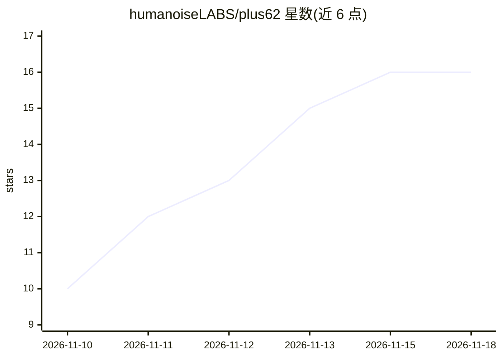

# humanoiseLABS/plus62

⭐ 16 · TypeScript · MIT · 推送 2026-11-15 · [GitHub](https://github.com/humanoiseLABS/plus62) · [官网](https://humanoise.vercel.app/) · 组织维护

**给编码 Agent 装印尼语开发者人设与输出规范层的 CLI 工具**

面向 AI 编码 Agent 的指令与护栏层：通过 npx 安装，向 Claude Code、OpenCode、Antigravity、Cursor、Qoder、Copilot 等工具的项目写入 CLAUDE.md/AGENTS.md 受管块与技能文件，注入 Bahasa Indonesia 开发者人设（lu/gw 用语）、去企业式开场白、抑制泄露的推理输出，并附 Risk Class 0–4 安全护栏。提供 install/doctor/update/uninstall/eval/measure 等命令，manifest 记录写入路径以便干净卸载。部分适配器的兼容性标注为 documented, not verified；Qoder 的兼容性评估未完成，不作兼容声明。

## 筛选速览

| 维度 | 判定 | 备注 |
|---|---|---|
| AI 角色 | `ai-ecosystem` | LLM/agent 周边工具 |
| 许可风险 | `permissive` | MIT |
| 部署形态 | `library` | 以包/库形式分发 |
| 模型依赖 | — | README 未给出锁定关系 |
| 硬件要求 | — | 无带数字的原话,不猜 |
| 安装摩擦 | `low` | 无编译、无系统依赖或容器化 |
| 成熟度 | `idea` | |

## 能力要点

- 6 类适配器向 CLAUDE.md/AGENTS.md/技能树写入受管块与 persona 文件
- install/doctor/update/uninstall 全生命周期命令，manifest 记录写入路径
- 适配器覆盖表区分 verified 与 documented not verified 状态
- measure 命令输出 token 预算，eval 支持 baseline/treatment 无头评测

## 适用场景

- 让编码 Agent 用印尼语开发者口吻直接回复，去掉模板化开场
- 给多个编码 Agent 统一注入输出风格与安全护栏
- 在团队项目中批量安装和卸载 persona 指令层

## 场景标签

`提示工程` · 领域:Agent 开发

## 证据(README 行号)

> L8: **HumanoiseLABS (`@humanoiseLABS`)** builds zero-fluff instruction & guardrail layers for AI coding agents across tw
> L98: `--adapter` decides **which files land where**. Pick it from the agent, not from the folder — installing
> L103: |Claude Code (default)|`npx @humanoiselabs/plus62 install --target <project>`|`CLAUDE.md` block + `.claude/skills/

## 星数曲线

2026-11-10 10 → 2026-11-18 16（+6）

---
*卡片 v1 · prompt 1.4 · 生成 2026-11-18 · 置信度 high · 依据 README sha `853bebcc9617` · [字段定义](../../DATASET.md)*
