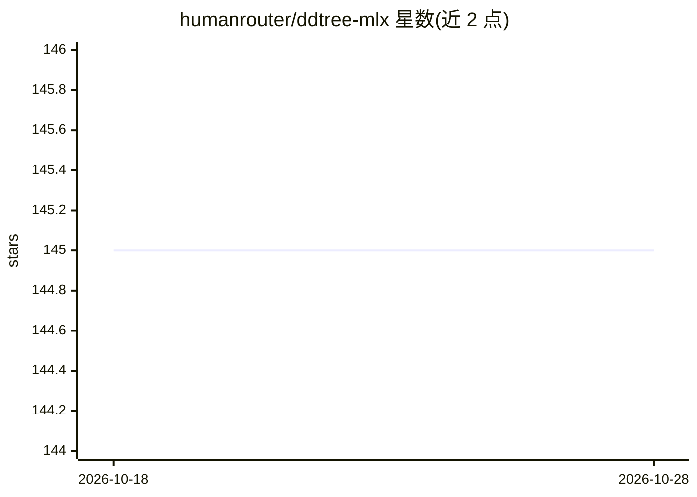

# humanrouter/ddtree-mlx

⭐ 145 · Python · 推送 2026-04-15 · [GitHub](https://github.com/humanrouter/ddtree-mlx) · 组织维护

**Apple Silicon 上的树状投机解码实现，加速 MLX 推理**

基于论文 Accelerating Speculative Decoding with Block Diffusion Draft Trees 的 MLX 移植，为 Apple Silicon 提供 DFlash 扩展：从逐位置 logits 构建草稿树，一次前向传播验证全树，接受更多 token。含自定义 Metal 内核支持 Qwen 3.5 27B 混合架构（GatedDeltaNet 循环层+注意力层），并提供 OpenAI 兼容服务器与 Python API。限制：需存在匹配目标模型的 DFlash 草稿模型（目前仅 Qwen 3.5 系列），需 Apple Silicon（M1-M4）与约 19GB 内存。

## 筛选速览

| 维度 | 判定 | 备注 |
|---|---|---|
| AI 角色 | `ai-ecosystem` | LLM/agent 周边工具 |
| 许可风险 | `none` | — |
| 部署形态 | `library` | 以包/库形式分发 |
| 模型依赖 | — | README 未给出锁定关系 |
| 硬件要求 | — | 无带数字的原话,不猜 |
| 安装摩擦 | `low` | 无编译、无系统依赖或容器化 |
| 成熟度 | — | 结构信号不足 |

## 能力要点

- 树状投机解码：一次前向验证整棵草稿树，输出无损（每 token 经目标模型验证）
- 自定义 Metal 内核处理循环层的 parent-indexed GatedDelta 递推
- 提供 OpenAI 兼容服务器（ddtree_server.py）与 Python API
- 架构级实现，同一模型族的任意量化均适用

## 适用场景

- 在 Mac 上加速 Qwen 3.5 系列的代码/结构化文本生成
- 通过 OpenAI 兼容接口接入现有客户端做本地推理
- 复现论文中的树状投机解码基准测试

## 场景标签

`推理引擎` · 领域:训练与推理

## 证据(README 行号)

> L3: **Tree-based speculative decoding for Apple Silicon.** ~10-15% faster than DFlash, ~1.5x faster than autoregressive 
> L67: ```bash
> L68: python ddtree_server.py --port 8006

## 星数曲线



2026-10-18 145 → 2026-10-28 145（+0）


---
*卡片 v1 · prompt 1.4 · 生成 2026-10-23 · 置信度 mid · 依据 README sha `a6664d52034c` · [字段定义](../../DATASET.md)*
