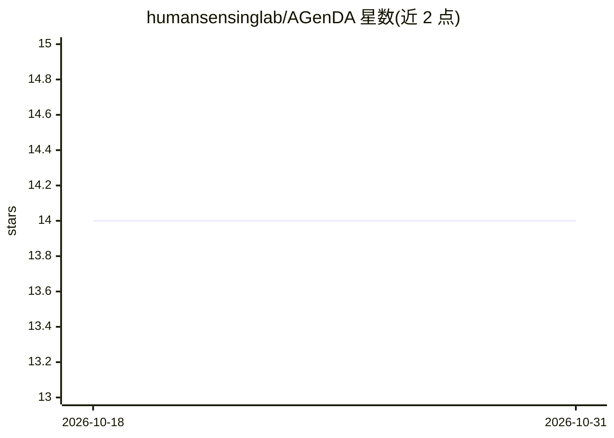

# humansensinglab/AGenDA

⭐ 14 · Python · 推送 2025-12-01 · [GitHub](https://github.com/humansensinglab/AGenDA) · [官网](https://humansensinglab.github.io/AGenDA/) · 组织维护

**弱监督域自适应航拍车辆检测的代码与数据集**

ICCV 2025 论文官方代码：将航拍图像中的车辆检测器适应到未见过的目标域，采用弱监督方式。流程分为数据生成与数据标注两个阶段，README 提供虚拟环境创建（conda, Python 3.9）等环境配置说明，各阶段详细指引与数据准备说明链接外部文档，并上传了各阶段的 checkpoints 供下载使用。代码基于 diffusers、DAAM 与 AttnDreamBooth 构建，属学术研究成果发布。

## 筛选速览

| 维度 | 判定 | 备注 |
|---|---|---|
| AI 角色 | `ai-native` | 本体是模型或模型工具 |
| 许可风险 | `none` | — |
| 部署形态 | `None` |  |
| 模型依赖 | — | README 未给出锁定关系 |
| 硬件要求 | — | 无带数字的原话,不猜 |
| 安装摩擦 | `low` | 无编译、无系统依赖或容器化 |
| 成熟度 | — | 结构信号不足 |

## 能力要点

- 两阶段流程：数据生成与数据标注
- 提供各阶段 checkpoints 下载
- 基于 diffusers/DAAM/AttnDreamBooth 构建

## 适用场景

- 复现论文中的跨域车辆检测实验
- 研究航拍图像域自适应检测方法
- 使用其数据集做目标检测研究

## 场景标签

`目标检测` · 领域:感知与多模态

## 证据(README 行号)

> L2: This is the official code for our ICCV 2025 paper:
> L3: > Adapting Vehicle Detectors for Aerial Imagery to Unseen Domains with Weak Supervision

## 星数曲线

2026-10-18 14 → 2026-10-31 14（+0）

---
*卡片 v1 · prompt 1.4 · 生成 2026-10-31 · 置信度 high · 依据 README sha `f3a79a15c5bb` · [字段定义](../../DATASET.md)*
