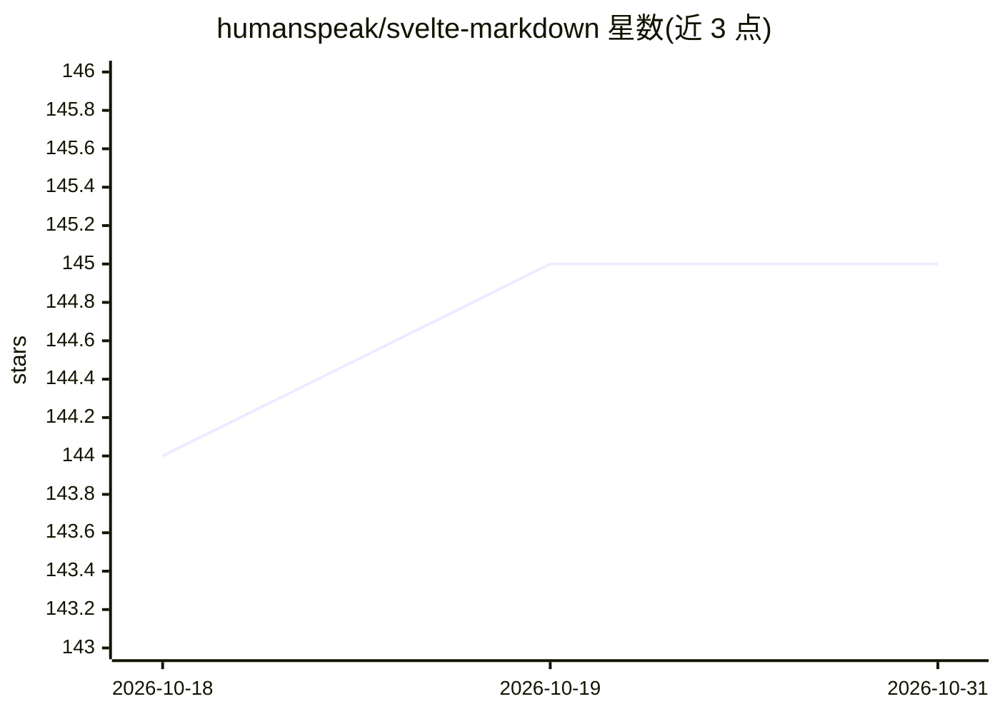

# humanspeak/svelte-markdown

⭐ 145 · TypeScript · MIT · 推送 2026-10-28 · [GitHub](https://github.com/humanspeak/svelte-markdown) · [官网](https://markdown.svelte.page) · 组织维护

**面向 Svelte 5 的 Markdown/HTML 渲染组件，适配 AI agent 流式输出**

由 Humanspeak 维护的 Svelte 5 Markdown 渲染组件，基于 Marked 与 HTMLParser2，支持混合渲染 Markdown 与 HTML，默认开启 XSS 防护（协议白名单、剥离 on* 处理器）。针对 LLM 流式输出提供增量解析、乱序分片重组（writeChunk offset）、LRU token 缓存。允许通过 Svelte 5 snippet 或组件自定义渲染器，支持任意自定义 HTML 标签路由。要求 Svelte 5 与 Node.js 22+，通过 npm/pnpm/yarn 安装。本体是通用 Markdown 渲染器，AI 流式输出为其适配场景。

## 筛选速览

| 维度 | 判定 | 备注 |
|---|---|---|
| AI 角色 | `ai-enhanced` | 去掉 AI 部分产品仍成立 |
| 许可风险 | `permissive` | MIT |
| 部署形态 | `library` | 以包/库形式分发 |
| 模型依赖 | — | README 未给出锁定关系 |
| 硬件要求 | — | 无带数字的原话,不猜 |
| 安装摩擦 | `low` | 无编译、无系统依赖或容器化 |
| 成熟度 | — | 结构信号不足 |

## 能力要点

- Markdown 与 HTML 单一来源混合渲染，默认开启 URL/属性消毒
- LLM 流式增量解析与乱序分片重组（writeChunk({value, offset})）
- LRU token 缓存避免重复解析已见内容
- Svelte 5 snippet 内联覆盖渲染器与任意自定义 HTML 标签路由

## 适用场景

- 在 Svelte 应用中流式渲染 Claude Code、ChatGPT 等 agent 的混合 Markdown/HTML 输出
- 为 agent 输出中的自定义标签（如 tool-call、thinking）接入自有组件
- 构建需要 XSS 防护默认开启的 Markdown 展示界面

## 场景标签

 · 领域:前端/UI 组件

## 证据(README 行号)

> L31: - ⚡ LRU token caching avoids repeated parsing of previously seen content
> L78: ## Rendering AI Agent Output

## 星数曲线

2026-10-18 144 → 2026-10-31 145（+1）

---
*卡片 v1 · prompt 1.4 · 生成 2026-10-22 · 置信度 high · 依据 README sha `b603ba9fea18` · [字段定义](../../DATASET.md)*
