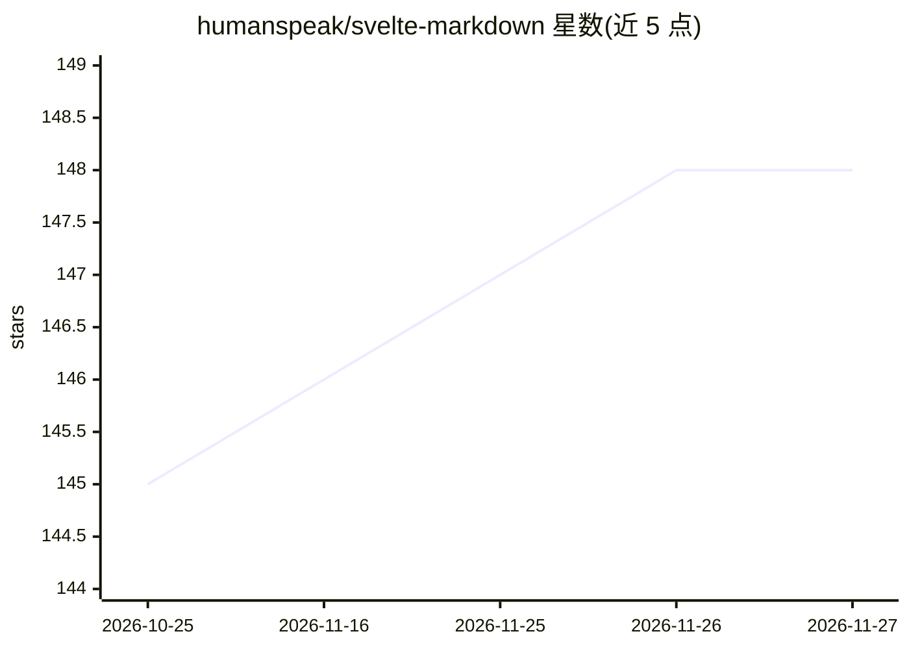

# humanspeak/svelte-markdown

⭐ 148 · TypeScript · MIT · 推送 2026-11-15 · [GitHub](https://github.com/humanspeak/svelte-markdown) · [官网](https://markdown.svelte.page) · 组织维护

**面向 Svelte 5 的 Markdown/HTML 渲染组件，支持 LLM 流式输出**

Svelte 5 组件库，将 Markdown 与 HTML 渲染为 Svelte 组件输出。面向渲染 AI agent（Claude Code、ChatGPT 等）流式输出的场景：提供增量解析与 token 复用的流式 API（writeChunk/resetStream）、乱序分片重组、默认 URL 与属性消毒（协议白名单、on* 处理器剥离）、LRU token 缓存。依赖 Svelte 5 与 Marked/HTMLParser2，支持 marked 扩展与自定义渲染器/snippet 覆盖，可选 Shiki 或 TanStack Highlight 语法高亮。

## 筛选速览

| 维度 | 判定 | 备注 |
|---|---|---|
| AI 角色 | `ai-ecosystem` | LLM/agent 周边工具 |
| 许可风险 | `permissive` | MIT |
| 部署形态 | `library` | 以包/库形式分发 |
| 模型依赖 | — | README 未给出锁定关系 |
| 硬件要求 | — | 无带数字的原话,不猜 |
| 安装摩擦 | `low` | 无编译、无系统依赖或容器化 |
| 成熟度 | — | 结构信号不足 |

## 能力要点

- LLM 流式渲染：增量解析、token 复用与乱序分片重组（writeChunk 带 offset）
- 默认 XSS 消毒：javascript: URL 与 on* 处理器剥离，流式渲染中同样生效
- LRU token 缓存避免重复解析；可选 Shiki/TanStack Highlight 高亮
- 支持自定义 HTML 标签路由到自有组件及 marked 扩展（如 KaTeX）

## 适用场景

- 在 Svelte 5 应用中渲染 ChatGPT/Claude 等 agent 的流式 Markdown 回答
- 渲染含 HTML 片段的 agent 输出并保持 XSS 消毒
- 按白名单限制可渲染的 HTML 标签或 markdown 元素
- 自定义 <tool-call>、<thinking> 等 agent 标签到业务组件

## 场景标签

 · 领域:前端开发/LLM 输出渲染

## 证据(README 行号)

> L32: - 📡 LLM streaming with incremental parsing and token reuse (about 2–3 ms per frame on the mixed-prose benchmark bel
> L78: ## Rendering AI Agent Output

## 星数曲线

2026-10-25 145 → 2026-11-27 148（+3）

---
*卡片 v1 · prompt 1.4 · 生成 2026-11-27 · 置信度 high · 依据 README sha `85a248be1608` · [字段定义](../../DATASET.md)*
