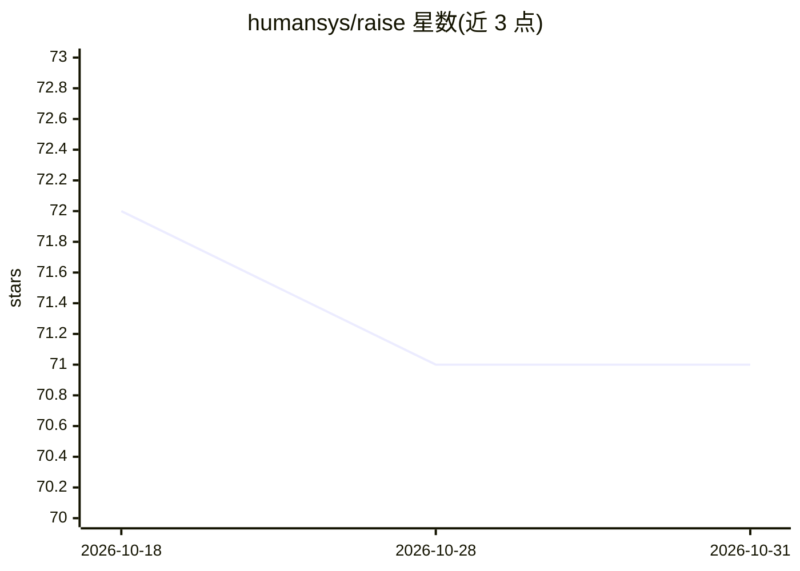

# humansys/raise

⭐ 71 · Python · Apache-2.0 · 推送 2026-10-23 · [GitHub](https://github.com/humansys/raise) · [官网](https://raiseframework.ai) · 组织维护

**AI 辅助软件工程的确定性治理层：门禁+状态机+溯源**

面向使用 AI 编码助手的开发团队的 CLI 工具：将工作流组织为可恢复的阶段状态机（story-start→design→plan→implement→review→close），在阶段边界运行用户配置的真实命令门禁（测试/lint/类型检查），失败即阻断推进；产出 scope.md、design.md、plan.md 等版本化工件以满足 SOC 2/ISO 27001/EU AI Act 溯源。另提供 AST 派生的调用/依赖知识图谱、跨工具持久记忆与 Jira/Confluence 适配。Apache-2.0 开源核心，另有 RaiSE Pro 商业版；兼容 Claude Code/Cursor/Aider 等工具但完整集成程度因工具而异。

## 筛选速览

| 维度 | 判定 | 备注 |
|---|---|---|
| AI 角色 | `ai-ecosystem` | LLM/agent 周边工具 |
| 许可风险 | `permissive` | Apache-2.0 |
| 部署形态 | `library` | 以包/库形式分发 |
| 模型依赖 | — | README 未给出锁定关系 |
| 硬件要求 | — | 无带数字的原话,不猜 |
| 安装摩擦 | `low` | 无编译、无系统依赖或容器化 |
| 成熟度 | — | 结构信号不足 |

## 能力要点

- 阶段边界的确定性门禁：测试/lint/类型检查以真实命令运行，失败阻断工作流
- 版本化工件链（scope→design→plan→gate 结果）支持合规审计
- AST 派生的调用/依赖知识图谱与跨 AI 工具的可移植记忆
- Supervised/Delegated/Autonomous 三档自主级别

## 适用场景

- 在 AI 编码助手工作流中强制执行质量门禁并留存决策证据
- 为合规审计（SOC 2/ISO 27001/EU AI Act）生成可追溯的变更工件
- 为 agent 提供基于真实调用关系的代码库上下文

## 场景标签

`工作流自动化` `知识图谱` · 领域:效率与自动化

## 证据(README 行号)

> L25: RaiSE is not another coding assistant. It's the governance layer that coordinates what your tools already do.
> L3: AI coding assistants are fast, but their context resets between sessions, quality checks are opt-in, and decision hi

## 星数曲线

2026-10-18 72 → 2026-10-31 71（-1）

---
*卡片 v1 · prompt 1.4 · 生成 2026-10-24 · 置信度 high · 依据 README sha `1722583a9fc6` · [字段定义](../../DATASET.md)*
