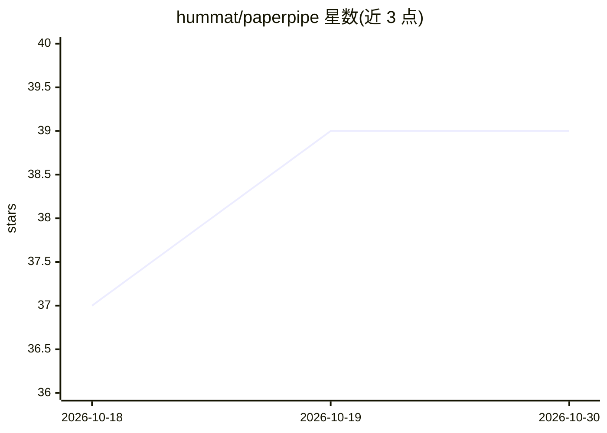

# hummat/paperpipe

⭐ 39 · Python · MIT · 推送 2026-10-07 · [GitHub](https://github.com/hummat/paperpipe) · [官网](https://hummat.github.io/paperpipe/) · 个人维护

**为编码 Agent 服务的本地论文库：提取公式与上下文供查验代码**

面向实现论文的开发者与编码 Agent 的本地论文管理 CLI：通过 papi 命令从 arXiv、Semantic Scholar 等来源添加论文，下载 PDF 与 LaTeX 源码，生成面向实现的摘要、带变量定义的公式清单（equations.md）与 TL;DR。提供精确/BM25（SQLite FTS5）/混合搜索，支持 PaperQA2 与 LEANN 两种 RAG 后端做跨论文问答，并通过 skill 与 MCP 服务器集成 Claude Code、Codex、Gemini CLI，使 Agent 能基于论文原文检索片段并逐符号核验代码。以 Python 包安装（uv/pip），LEANN 后端可配合本地 Ollama。

## 筛选速览

| 维度 | 判定 | 备注 |
|---|---|---|
| AI 角色 | `ai-ecosystem` | LLM/agent 周边工具 |
| 许可风险 | `permissive` | MIT |
| 部署形态 | `library` | 以包/库形式分发 |
| 模型依赖 | local-ok | 支持本地模型 |
| 硬件要求 | — | 无带数字的原话,不猜 |
| 安装摩擦 | `low` | 无编译、无系统依赖或容器化 |
| 成熟度 | — | 结构信号不足 |

## 能力要点

- papi add 从 arXiv/Semantic Scholar 下载 PDF+LaTeX 并生成公式/摘要/TL;DR
- BM25（SQLite FTS5）、精确与混合三种搜索模式
- PaperQA2 与 LEANN 两种 RAG 后端支持跨论文问答
- papi install 向 Claude Code/Codex/Gemini CLI 安装 skill 与 MCP 服务器

## 适用场景

- 实现论文时让编码 Agent 引用原文公式核验代码
- 维护本地论文库并按标签、公式、摘要检索
- 跨论文提问某类技术方法的差异与共性

## 场景标签

`RAG` `科研工具` `语义搜索` · 领域:知识与检索

## 证据(README 行号)

> L7: **The solution:** paperpipe maintains a local paper database with PDFs, LaTeX source (when available), extracted equ
> L252: paperpipe provides MCP servers for retrieval-only workflows:

## 星数曲线

2026-10-18 37 → 2026-10-30 39（+2）

---
*卡片 v1 · prompt 1.4 · 生成 2026-10-25 · 置信度 high · 依据 README sha `fe40020d99d8` · [字段定义](../../DATASET.md)*
