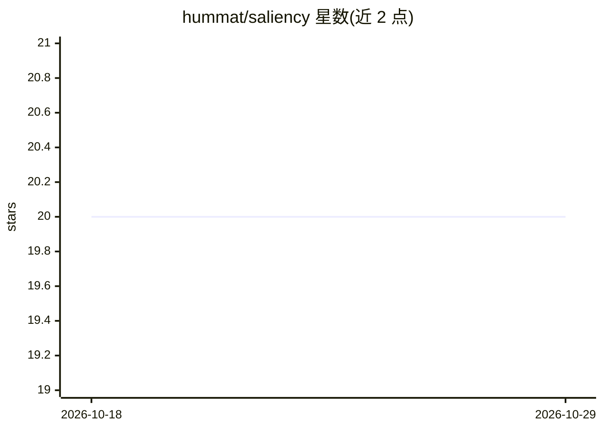

# hummat/saliency

⭐ 20 · Jupyter Notebook · GPL-3.0 · 推送 2026-02-15 · [GitHub](https://github.com/hummat/saliency) · [官网](https://hummat.github.io/saliency/) · 个人维护

**PyTorch 显著性图方法库：多种归因算法的实现**

基于 PyTorch 的显著性（saliency）方法实现库，包含 Vanilla Gradients、Guided Backpropagation、Integrated Gradients、(Guided) Grad-CAM、XRAI 及对应的 SmoothGrad 变体，用于生成神经网络预测的归因可视化。方法兼容 torchvision 包中的模型，已在 VGG、ResNet、DenseNet、Inception/GoogLeNet 变体上测试；其中 Inception/GoogLeNet 需将 ReLU 改为模块形式才能正常使用 Guided Backpropagation 与 Grad-CAM。实现参照 TensorFlow 对应的 saliency 仓库并复用其部分代码（主要用于 XRAI）。提供教程 notebook 与最小示例代码。

## 筛选速览

| 维度 | 判定 | 备注 |
|---|---|---|
| AI 角色 | `ai-ecosystem` | LLM/agent 周边工具 |
| 许可风险 | `viral` | GPL-3.0 |
| 部署形态 | `None` |  |
| 模型依赖 | — | README 未给出锁定关系 |
| 硬件要求 | — | 无带数字的原话,不猜 |
| 安装摩擦 | `low` | 无编译、无系统依赖或容器化 |
| 成熟度 | — | 结构信号不足 |

## 能力要点

- 实现 Vanilla Gradients、Integrated Gradients、(Guided) Grad-CAM、XRAI 等方法及 SmoothGrad 变体
- 声明兼容 torchvision 全部模型，已测试 VGG/ResNet/DenseNet/Inception 变体
- 提供教程 notebook 与最小使用示例

## 适用场景

- 对 CNN 分类预测生成显著性图/归因可视化
- 对比多种归因方法在 torchvision 模型上的输出
- 模型解释性研究中的算法复现与实验

## 场景标签

 · 领域:机器学习/模型可解释性

## 证据(README 行号)

> L1: # Saliency Methods
> L3: This repository contains code for the following saliency techniques:

## 星数曲线

2026-10-18 20 → 2026-10-29 20（+0）

---
*卡片 v1 · prompt 1.4 · 生成 2026-10-28 · 置信度 high · 依据 README sha `60aacd508847` · [字段定义](../../DATASET.md)*
