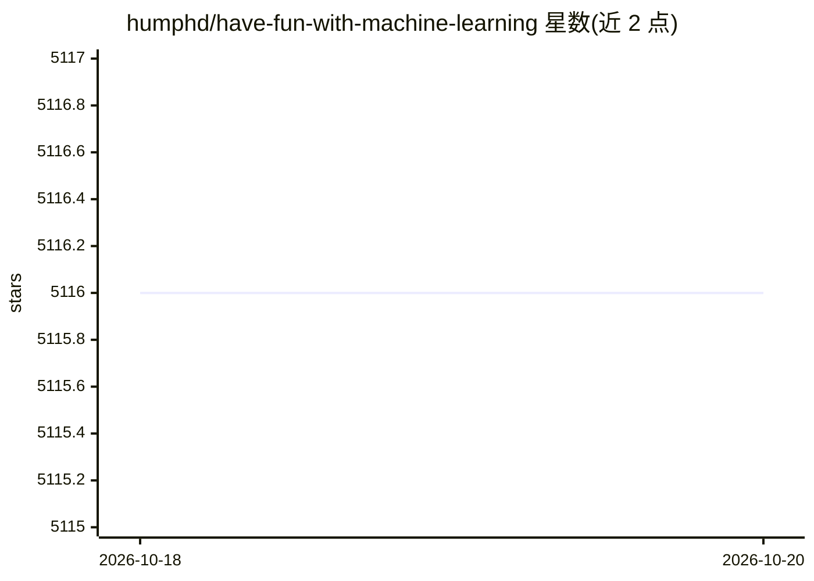

# humphd/have-fun-with-machine-learning

⭐ 5,116 · Python · NOASSERTION · 推送 2026-09-04 · [GitHub](https://github.com/humphd/have-fun-with-machine-learning) · 个人维护

**面向零基础程序员的图像分类神经网络入门教程**

面向无 AI 背景程序员的手把手教程：以区分海豚与海马图片为目标，指导安装 Caffe 深度学习框架与 NVIDIA DIGITS 训练前端，完成数据集准备、从零训练 CNN、用 AlexNet/GoogLeNet 预训练网络微调并测试。不涉及网络设计理论与数学推导，以实践者视角操作现有工具。原生安装 Caffe 较繁琐，也提供 Docker 一键运行 Caffe+DIGITS 容器的路径；作者在无独立 GPU 的 MacBook Pro 上使用 OpenCL 分支完成全部训练。

## 筛选速览

| 维度 | 判定 | 备注 |
|---|---|---|
| AI 角色 | `ai-knowledge` | 知识聚合/清单类 |
| 许可风险 | `none` | NOASSERTION |
| 部署形态 | `self-host` | docker 或自建部署 |
| 模型依赖 | — | README 未给出锁定关系 |
| 硬件要求 | — | 无带数字的原话,不猜 |
| 安装摩擦 | `low` | 无编译、无系统依赖或容器化 |
| 成熟度 | `idea` | |

## 能力要点

- 用 Caffe + DIGITS 完成图像分类训练的完整流程演练
- 从零训练与微调 AlexNet/GoogLeNet 预训练网络两种路径对比
- 提供 Docker 一键运行 Caffe+DIGITS 容器的安装选项
- 附 dolphins-and-seahorses 示例图片数据集

## 适用场景

- 零 AI 基础的程序员上手神经网络图像分类
- 学习如何微调预训练网络以适配自有小数据集
- 通过 Docker 快速搭建 Caffe/DIGITS 练习环境

## 场景标签

`教程课程` · 领域:学习与行业

## 证据(README 行号)

> L7: This is a **hands-on guide** to machine learning for programmers with *no background* in
> L14: In this guide our goal will be to write a program that uses machine learning to predict, with a
> L22: To do that we’re going to train and use a Convolutional Neural Network (CNN).

## 星数曲线

2026-10-18 5,116 → 2026-10-20 5,116（+0）

---
*卡片 v1 · prompt 1.4 · 生成 2026-10-20 · 置信度 mid · 依据 README sha `4bd71383df2c` · [字段定义](../../DATASET.md)*
