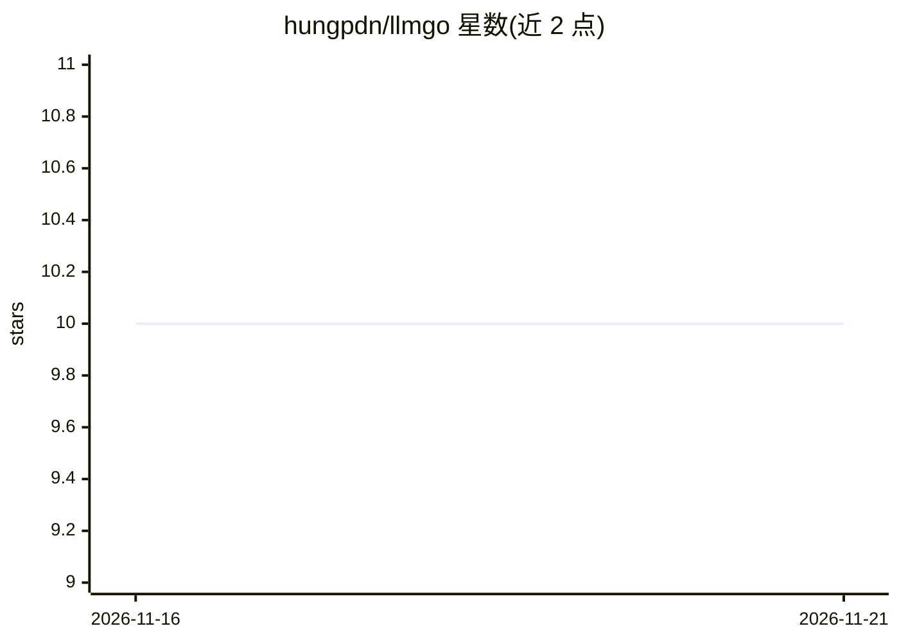

# hungpdn/llmgo

⭐ 10 · Go · MIT · 推送 2026-03-14 · [GitHub](https://github.com/hungpdn/llmgo) · [官网](https://deepwiki.com/hungpdn/llmgo) · 个人维护

**Go 开发者的 LLM Agent 编排框架**

以 Go 库形式提供的 LLM Agent 编排框架，提供 ReActAgent、PlannerAgent、基于 LLMRouter/ChainRouter 的多 Agent 协调、并发 RAG 管道、工具注册与反射式 JSON Schema 生成、BufferMemory/RedisMemory 上下文管理。架构基于 Actor Model 与 Goroutine/Channel 实现无锁交互。当前处于 v0.0.1 里程碑，云模型 Provider（OpenAI/Anthropic/Gemini）标注为未完成；需 Go 1.22+。

## 筛选速览

| 维度 | 判定 | 备注 |
|---|---|---|
| AI 角色 | `ai-ecosystem` | LLM/agent 周边工具 |
| 许可风险 | `permissive` | MIT |
| 部署形态 | `None` |  |
| 模型依赖 | local-ok | 支持本地模型 |
| 硬件要求 | — | 无带数字的原话,不猜 |
| 安装摩擦 | `low` | 无编译、无系统依赖或容器化 |
| 成熟度 | `idea` | |

## 能力要点

- 内置 ReActAgent 与 PlannerAgent 两类 Agent
- LLMRouter/ChainRouter 多 Agent 协调
- 并发 RAG 管道与 nanovec 嵌入式向量库集成
- 零拷贝分块、零 GC 缓冲池与指数退避重试

## 适用场景

- 在 Go 服务中构建带工具调用的 Agent
- 搭建文档摄取与检索的 RAG 管道
- 用本地 Ollama 模型开发多 Agent 协作系统

## 场景标签

`Agent 框架` `多智能体` `RAG` · 领域:Agent 开发

## 证据(README 行号)

> L11: **llmgo** is a high-performance, modular framework designed to bring the most powerful concepts of the Python AI ec
> L15: - **Built-in Agents:** `ReActAgent` (Reason + Act loop) and `PlannerAgent` (Plan-and-Execute).
> L140: - `pkg/llm`: Provider integrations (Ollama, etc.).

## 星数曲线

2026-11-16 10 → 2026-11-21 10（+0）

---
*卡片 v1 · prompt 1.4 · 生成 2026-11-19 · 置信度 high · 依据 README sha `4788cf4c437e` · [字段定义](../../DATASET.md)*
