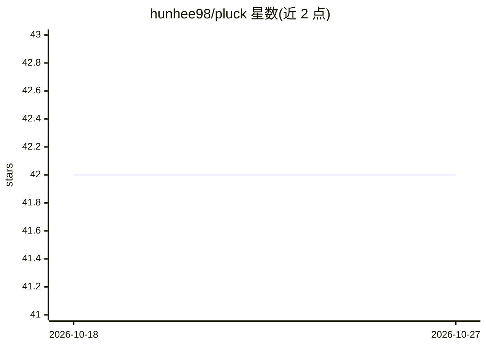

# hunhee98/pluck

⭐ 42 · Rust · MIT · 推送 2026-06-02 · [GitHub](https://github.com/hunhee98/pluck) · 个人维护 · 中文 README

**MCP 原生代码检索守护进程：为 AI agent 省 token 地读搜代码**

本地 Rust 常驻守护进程，通过 MCP 向 AI 编码 agent 暴露符号级代码读取与搜索工具，替代 cat/grep 作为默认读码方式。核心机制：Tree-sitter AST 分块、BM25F+静态嵌入（potion-code-16M，约 60MB，无 transformer 推理）混合排序、会话级去重（重复片段替换为 1-token 占位符）、智能大纲读取（实测省 84-88% 读取 token）、CI 日志压缩（中位 71%），每个工具带 --raw 字节级回退。支持 26 种格式的 AST 分块，提供独立 CLI。性能数字由 baseline.json 门控回归测试约束；持久化磁盘索引仍在路线图（v0.7.0），未实现。

## 筛选速览

| 维度 | 判定 | 备注 |
|---|---|---|
| AI 角色 | `ai-ecosystem` | LLM/agent 周边工具 |
| 许可风险 | `permissive` | MIT |
| 部署形态 | `self-host` | docker 或自建部署 |
| 模型依赖 | — | README 未给出锁定关系 |
| 硬件要求 | — | 无带数字的原话,不猜 |
| 安装摩擦 | `low` | 无编译、无系统依赖或容器化 |
| 成熟度 | — | 结构信号不足 |

## 能力要点

- MCP 暴露 10 个工具：read/grep/search/symbol/peek/expand/impact/deps/digest/plan
- BM25F + 静态嵌入（potion-code-16M）RRF 混合排序，语义检索无 transformer 推理
- 会话去重：重复读取的代码块替换为 1-token 占位符
- 全部工具带 --raw 回退，与 cat/grep 字节一致；26 种格式 AST 分块

## 适用场景

- 让 Claude Code / Codex / Cursor 等 agent 用更少 token 读取和搜索代码库
- 在终端独立使用 pluck 索引、搜索和查看代码大纲
- 压缩构建/测试日志后再交给 agent 分析

## 场景标签

`语义搜索` · 领域:知识与检索

## 证据(README 行号)

> L19: **pluck** is a local Rust daemon that replaces `cat` and `grep` as the default way AI agents read and search code. 
> L93: Agents call specific tools depending on what they need. Bash is the fallback, not the default.

## 星数曲线

2026-10-18 42 → 2026-10-27 42（+0）

---
*卡片 v1 · prompt 1.4 · 生成 2026-10-25 · 置信度 mid · 依据 README sha `cdb61ddd72de` · [字段定义](../../DATASET.md)*
