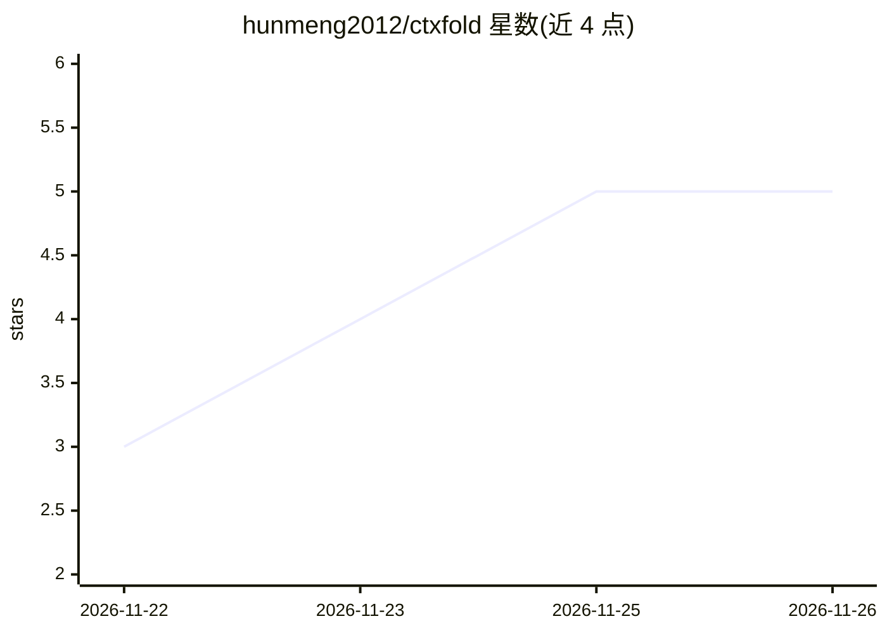

# hunmeng2012/ctxfold

⭐ 5 · JavaScript · MIT · 推送 2026-11-23 · [GitHub](https://github.com/hunmeng2012/ctxfold) · 个人维护 · 中文 README

**给 Pi Agent 分层注入与按任务裁剪系统提示词的控制台**

面向 Pi Agent 的提示词管理工具：将七份分层的系统提示词（常驻底座、放行策略、工程、逆向、Web 渗透、CTF、应急响应）通过扩展、AGENTS.md 区块、override 接管、清洗、上游补丁五条通道注入 Pi Agent，并按任务族关键词计分决定裁剪哪些层。支持备份与 revert/uninstall 可逆卸载，提供 WinForms 原生桌面壳与 CLI 两类入口，零运行时依赖。需要 Pi Agent 环境与 Node 运行 CLI。

## 筛选速览

| 维度 | 判定 | 备注 |
|---|---|---|
| AI 角色 | `ai-ecosystem` | LLM/agent 周边工具 |
| 许可风险 | `permissive` | MIT |
| 部署形态 | `desktop` | 安装包/桌面程序 |
| 模型依赖 | — | README 未给出锁定关系 |
| 硬件要求 | — | 无带数字的原话,不猜 |
| 安装摩擦 | `low` | 无编译、无系统依赖或容器化 |
| 成熟度 | — | 结构信号不足 |

## 能力要点

- 七层提示词分文件管理，用户层目录优先级高于包内预设
- 按任务族（工程/逆向/Web 渗透/CTF/应急响应）关键词计分裁剪注入内容
- 五条注入通道分级，全部步骤有备份可逆
- WinForms 原生桌面壳，目标机无需安装 Node

## 适用场景

- 按安全任务类型给 Pi Agent 裁剪系统提示词
- 清理 AGENTS.md 里他人留下的提示词并接管系统提示词
- 给 Pi 打上游补丁调整 developer role 等 API 行为

## 场景标签

`提示工程` `网络安全` · 领域:Agent 开发

## 证据(README 行号)

> L5: **Pi Agent 的提示词控制台：分层注入、按任务裁剪、一键清洗、原生桌面壳。**
> L25: Pi Agent 的系统提示词来自三处：内置提示词、`~/.pi/agent/AGENTS.md`、以及扩展在 `before_agent_start` 里塞进去的内容。想改其中任何一处，一般都得手工编辑文件、算好顺序、还要担心下
> L65: |扩展（默认）|`~/.pi/agent/extensions/ctxfold/index.ts`，每轮在 `before_agent_start` 里注入|日常|与 `AGENTS.md` 并存，排在后面|

## 星数曲线

2026-11-22 3 → 2026-11-26 5（+2）

---
*卡片 v1 · prompt 1.4 · 生成 2026-11-22 · 置信度 high · 依据 README sha `2a873e216b08` · [字段定义](../../DATASET.md)*
