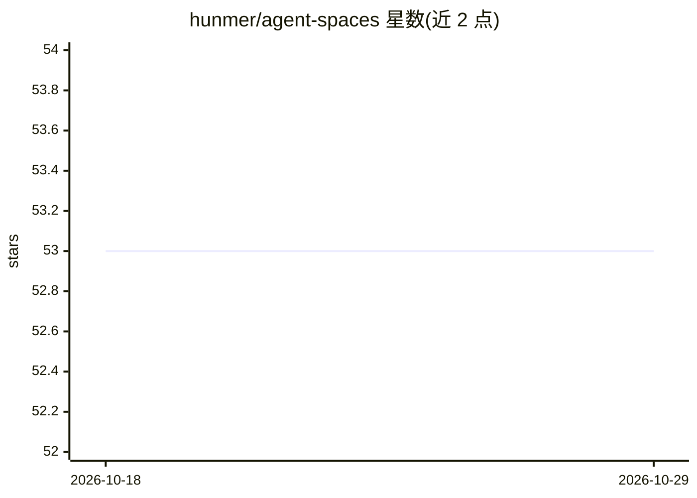

# hunmer/agent-spaces

⭐ 53 · TypeScript · 推送 2026-09-30 · [GitHub](https://github.com/hunmer/agent-spaces) · [官网](https://hunmer.github.io/agent-spaces/) · 个人维护 · 中文 README

**多 Agent 协作的可视化 DAG 工作流平台，编排 AI 任务自动化**

面向开发者与团队的 Agent 协作平台：以可视化 DAG 工作流引擎为核心，内置 40+ 节点（流程控制、agent_run、人机交互、SQLite 数据库、向量检索知识库、Mini App 界面、插件节点），支持 cron/Webhook/HTTP SSE/Issue 等多种触发与断点调试。Agent 层支持六种角色与六种运行时（Claude Code、OpenAI Codex、LangChain 等），可一键安装本地 CLI/SDK。附带 IDE 级前端（Monaco/xterm）、Git 集成、用量统计与移动端客户端；后端自部署需 Node.js>=20 与 pnpm>=9，许可证标注为 Private。

## 筛选速览

| 维度 | 判定 | 备注 |
|---|---|---|
| AI 角色 | `ai-ecosystem` | LLM/agent 周边工具 |
| 许可风险 | `none` | — |
| 部署形态 | `library` | 以包/库形式分发 |
| 模型依赖 | locked-api |  |
| 硬件要求 | — | 无带数字的原话,不猜 |
| 安装摩擦 | `low` | 无编译、无系统依赖或容器化 |
| 成熟度 | — | 结构信号不足 |

## 能力要点

- 可视化 DAG 编排引擎，40+ 内置节点 9 大分类，支持子流程嵌套
- 六种 Agent 角色 × 六种运行时（Claude Code/Codex/LangChain/Open Agent SDK/Hermes/Oh-My-Pi）
- 多种触发方式：cron、Webhook、HTTP SSE、WebSocket、Issue 事件、Agent 工具调用
- 一键发现/安装/更新本地 Agent CLI 与 SDK，含版本检测

## 适用场景

- 把重复的 AI 任务编排成可定时/事件触发的工作流
- 团队通过频道聊天、Issue 模板自动调度 Agent 协作
- 用 Mini App 节点在流程中收集人工输入再继续执行

## 场景标签

`多智能体` `工作流自动化` `Agent 框架` · 领域:Agent 开发

## 证据(README 行号)

> L3: 可视化工作流（Workflow）平台。用 DAG 拖拽编排工作流，混合调度 AI Agent、代码、数据库、知识库、人机交互与 Mini App 界面节点，把重复的 AI 任务沉淀成可复用、可触发、可观测的自动化流程。一个工作流可以
> L39: - **六种 Agent 运行时** — Claude Code / OpenAI Codex / LangChain / Open Agent SDK / Hermes / Oh-My-Pi，配置切换

## 星数曲线

2026-10-18 53 → 2026-10-29 53（+0）

---
*卡片 v1 · prompt 1.4 · 生成 2026-10-24 · 置信度 high · 依据 README sha `a0616db33fa9` · [字段定义](../../DATASET.md)*
