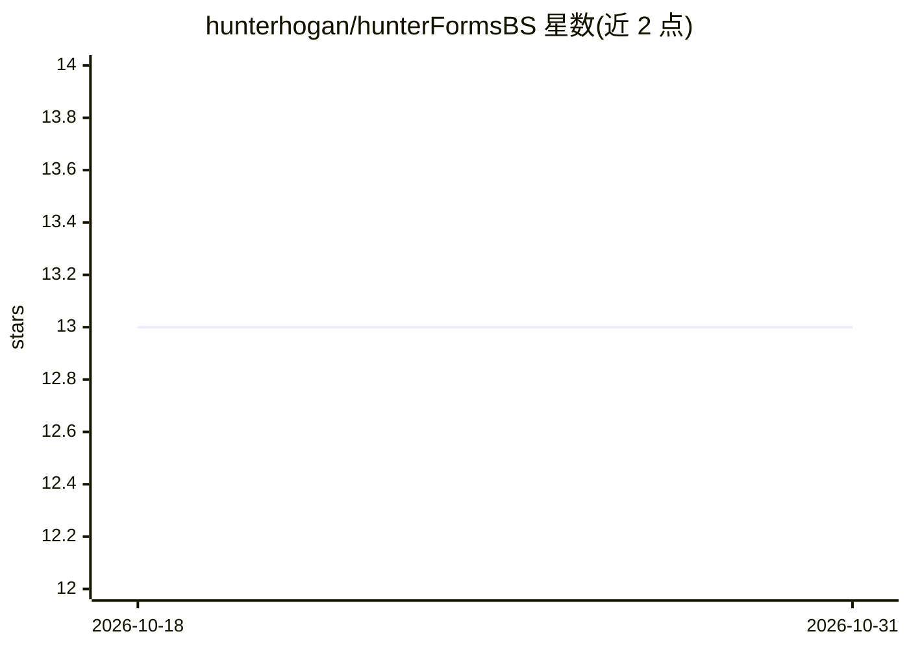

# hunterhogan/hunterFormsBS

⭐ 13 · Python · NOASSERTION · 推送 2026-10-29 · [GitHub](https://github.com/hunterhogan/hunterFormsBS) · 个人维护

**统一频带切分音乐源分离模型库：单入口表达 BS/梅尔/自定义分带**

PyTorch 实现的频带切分式音乐源分离模型包：以 BandSplitRotator 为唯一公开的分离器类，将 BS-RoFormer 风格的非重叠分带、MelBand 风格的运行时自动梅尔分带、以及显式自定义 mask_filter_bank 布尔矩阵三种频带布局统一为一个模型家族的不同配置。注意力块支持 RoPE/PoPE 切换、PyTorch SDPA 与可选 SageAttention 加速（需手动安装），可选 HyperACE 分割式掩码估计分支。包内含多分辨率 STFT 损失助手与类型化配置记录，附大量文献引用与迁移说明。面向使用 PyTorch 的音频研究开发者。

## 筛选速览

| 维度 | 判定 | 备注 |
|---|---|---|
| AI 角色 | `ai-native` | 本体是模型或模型工具 |
| 许可风险 | `none` | NOASSERTION |
| 部署形态 | `library` | 以包/库形式分发 |
| 模型依赖 | — | README 未给出锁定关系 |
| 硬件要求 | — | 无带数字的原话,不猜 |
| 安装摩擦 | `low` | 无编译、无系统依赖或容器化 |
| 成熟度 | — | 结构信号不足 |

## 能力要点

- BandSplitRotator 单类统一 BS 式/梅尔式/自定义三种频带布局
- RoPE/PoPE 位置编码切换，flash_attn 与可选 SageAttention 加速
- use_hyperACE=True 时启用分割式掩码估计分支
- 全类型标注（py.typed）并提供自上游代码库的迁移路径

## 适用场景

- 把既有 BS-RoFormer 或 MelBandRoformer 代码迁移到统一入口
- 研究自定义频带划分对源分离的影响
- 加载旧 checkpoint 时修正 mask_estimator_depth 解决尺寸不匹配

## 场景标签

 · 领域:音频/音乐源分离

## 证据(README 行号)

> L3: A flexible frequency-band splitter for music source separation, organized around a single separator family that can 
> L39: - `hunterFormsBS.bandSplitRotator.BandSplitRotator` is the primary unified entry point and the only public separato
> L153: `raw audio → STFT → band gathering → BandSplit → hierarchical attention → MaskEstimator → mask`

## 星数曲线

2026-10-18 13 → 2026-10-31 13（+0）

---
*卡片 v1 · prompt 1.4 · 生成 2026-10-31 · 置信度 high · 依据 README sha `56f578677f7d` · [字段定义](../../DATASET.md)*
